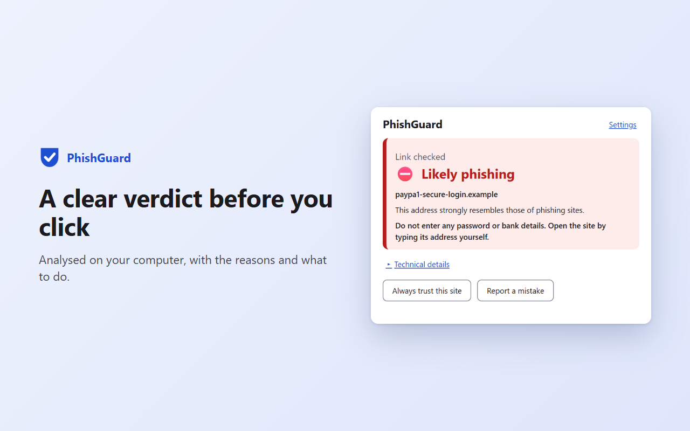
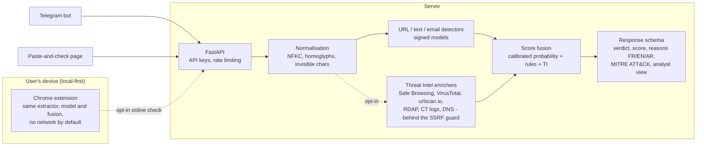

# PhishGuard

[](https://github.com/arixstoo/PhishGuard/actions/workflows/ci.yaml)
[](https://github.com/arixstoo/PhishGuard/actions/workflows/security.yml)
[](https://github.com/arixstoo/PhishGuard/actions/workflows/codeql.yml)
[](https://github.com/arixstoo/PhishGuard/actions/workflows/extension.yml)
[](https://github.com/arixstoo/PhishGuard/releases)
[](docs/mitre-attack.md)
[](LICENSE)


**Open-source, explainable and privacy-first phishing detection for URLs, SMS and emails.**
PhishGuard warns people at the exact moment they are about to click, with a clear verdict
and a one-sentence explanation, in French, English and Arabic.

**The problem.** Phishing is still one of the main ways attackers get in
([MITRE ATT&CK T1566](https://attack.mitre.org/techniques/T1566/)), and the people it
hurts most are the least equipped: protections are either paid enterprise products or
blocklists that only know a trap once it has been reported. PhishGuard judges a link the
first time it is seen, explains why, and does it **on your device**.



<!-- generated:key-figures:start -->
| Phishing links flagged | False alarms on legitimate pages | Precision if 1 % of links are phishing |
| :---: | :---: | :---: |
| **64 in 100** | **3 in 1,000** home pages, **40 in 1,000** inner pages | **48 %** |

*Deployed model `url_v2`, at its decision threshold, measured once on the most recent 21,004 URLs it never saw (temporal, domain-grouped test set). Recall at 1 % FPR: 0.668, below the project's 0.95 target. Source: [`docs/metrics/url_v2_test.json`](docs/metrics/url_v2_test.json).*
<!-- generated:key-figures:end -->

Analysis takes **2 to 4 ms** in the extension and **12 ms** (median, 50 requests/s) through
the API ([load test](docs/load-test.md)).

**Install:** Chrome Web Store *(not submitted yet; link added at publication)* · Firefox
*(prepared, [docs/store.md](docs/store.md))* · beta archive for testers:
[docs/beta.md](docs/beta.md) · 📖 [Documentation](https://arixstoo.github.io/PhishGuard/)
(quick start, FAQ, privacy, architecture, threat model, model cards).

**Start here:** [threat model](docs/threat-model.md) ·
[robustness report](docs/robustness-report.md) ·
[launch article](docs/launch/article.md) (what I learned, with the real numbers).

> **Status: beta.** Detection, API, extension, bot, deployment tooling and store packages
> are built and tested. Still pending, because they need the author's accounts and
> server: the production server, the Chrome Web Store listing and the public launch.

## Why it is different

- **Local-first**: the detection model runs on the user's device; by default no email
  content and no browsing history ever leave it.
- **Explainable**: every verdict comes with plain-language reasons, plus a technical view
  for analysts.
- **Honest**: metrics are measured on a temporal split, false positives are tracked as
  closely as missed detections, and robustness against evasion is benchmarked and published.

## Features

- [x] URL analysis: verdict (safe / suspicious / phishing), 0–100 score, plain-language reasons
- [x] SMS / text and raw email (`.eml`) analysis: SPF, DKIM, DMARC, display-vs-real links, attachments
- [x] Opt-in Threat Intelligence enrichment (Safe Browsing, VirusTotal, urlscan.io, RDAP, CT logs), off by default
- [x] Explanations (SHAP + readable reasons) and MITRE ATT&CK mapping
- [x] Adversarial robustness benchmark (homoglyphs, typosquatting, zero-width characters…) and defences
- [x] Hardened REST API (FastAPI, OpenAPI, rate limiting, SSRF guard, signed models)
- [x] Chrome extension with on-device inference and Gmail banner; Firefox build; Telegram bot; paste-and-check page
- [x] FR / EN / AR interface (right-to-left), keyboard and screen-reader accessible
- [x] Signed monthly model updates behind a non-regression gate; usage measured without tracking
- [ ] Public Chrome Web Store and Firefox listings, production API, `v1.0.0`

## Architecture



Details: [end-to-end analysis](docs/analysis.md) · [score fusion](docs/fusion.md) ·
[extension design](docs/extension-design.md).

## Current results

<!-- generated:current-results-url:start -->
**URL model** (`url_v1`, LightGBM, 25 offline lexical features), measured once on the most recent 21,004 URLs (temporal, domain-grouped test set). Full numbers and caveats: [`docs/model-card-url.md`](docs/model-card-url.md).

| PR-AUC | Recall @ 1 % FPR | Recall at decision threshold | FPR (homepages / internal pages) | Precision if 1 % of URLs are phishing |
| ---: | ---: | ---: | ---: | ---: |
| 0.939 | 0.755 | 73.9 % | 0.2 % / 6.4 % | 47.3 % |
<!-- generated:current-results-url:end -->

**SMS baseline** (TF-IDF + logistic regression on the
[UCI SMS Spam Collection](https://archive.ics.uci.edu/dataset/228/sms+spam+collection)),
spam = positive class, threshold 0.5. Full output: [`docs/metrics/sms_baseline.json`](docs/metrics/sms_baseline.json).

| Protocol | Precision | Recall | F1 | False positives | PR-AUC | Recall @ 1 % FPR | Test messages already seen in training |
| --- | --- | --- | --- | --- | --- | --- | --- |
| Naive random split (original 2022 project) | 0.952 | 0.933 | 0.942 | 7 / 966 | 0.978 | 0.946 | **139 / 1115** |
| **Deduplicated, then split (reference)** | **0.889** | **0.938** | **0.912** | **15 / 904** | **0.971** | **0.922** | **0** |

**Lesson learned:** the corpus contains 414 duplicate messages. With a naive random split,
12.5 % of the test set had already been seen during training, which inflated precision and
halved the apparent number of false positives. The original project reported "96 % accuracy";
on a dataset where 87 % of messages are legitimate, accuracy alone says very little. This
baseline is a starting point: the current false positive rate (1.7 %) is above the project
target of 1 %.

## Quick start

Requires Python 3.11+. On Windows, use WSL2.

```bash
git clone https://github.com/arixstoo/PhishGuard.git && cd PhishGuard
python -m venv .venv && source .venv/bin/activate
pip install -e '.[dev]'

pytest --cov=phishguard                 # run the tests
python scripts/train_sms_baseline.py    # download the dataset (SHA-256 verified) and reproduce the metrics
python scripts/fetch_feeds.py           # collect timestamped phishing and legitimate feeds into data/raw/
python scripts/build_dataset.py         # build data/processed/urls.parquet (normalized, deduplicated)
python scripts/audit_bias.py            # look for dataset shortcuts before training (docs/data-bias.md)
python scripts/split_dataset.py         # temporal, domain-grouped train/validation/test split (docs/split.md)
python scripts/evaluate_url_features.py # measure what each URL feature adds, on validation (docs/url-features.md)
make train-url                          # train and compare logistic regression, Random Forest, LightGBM (docs/url-models.md)
make evaluate-url                       # test-set evaluation at realistic phishing prevalence (docs/evaluation.md)
make errors-url                         # classify the 50 worst false positives and false negatives (docs/error-analysis-url.md)
make train-text                         # compare SMS text models, English corpus + French/Arabic set (docs/text-models.md)
python scripts/parse_email.py msg.eml   # SPF/DKIM/DMARC, sender mismatches, deceptive links, risky attachments (docs/email-parser.md)
make email-corpora && make train-email  # email score: transparent rules vs learned models (docs/email-score.md)
python -m phishguard.config             # which Threat Intel sources are enabled (optional keys in .env, docs/secrets.md)
make calibrate-url                      # calibrate the URL model probabilities on validation (docs/fusion.md)
make schema                             # regenerate the analysis response JSON Schema (docs/response-schema.md)
make explain-url                        # SHAP explanations of the URL model: global plot and 10 explained URLs (docs/explain-url.md)
make calibrate-text                     # calibrate the SMS model margin into a probability, on validation (docs/explain-text.md)
make robustness                         # recall and false positives under each evasion perturbation (docs/robustness-report.md)
make train-adversarial robustness-adversarial  # adversarial training (url_v2, text_v2) and its benchmark pass
make llm-phishing                       # SMS models on a local, LLM-written test set (docs/llm-phishing.md)
make plot-robustness                    # recall and false-positive chart of the robustness report (needs .[explain])
python scripts/check_enrichers.py URL   # query the real Threat Intel sources with your own keys (docs/enrichers.md)
make api                                # serve the HTTP API on 127.0.0.1:8000, interactive docs on /docs (docs/api.md)
make api-key NAME=extension-dev         # create an API key, shown once; only its SHA-256 is stored (docs/api.md)
```

Run `make help` to list the available commands.

### Production

The public API is served at `https://api-phishguard.vercel.app`: Vercel terminates TLS and
relays to a hardened server (Caddy, signed models, read-only containers) that refuses any
request not carrying the edge's secret header. Pushing a `v*` tag builds amd64 and arm64
images, scans them with trivy, publishes them to ghcr.io with signed provenance and deploys
them by digest, with automatic rollback. See [docs/deployment.md](docs/deployment.md) and
[docs/operations.md](docs/operations.md) (monitoring, Telegram alerts, encrypted backups).

## Roadmap

Each step is tracked as a GitHub issue, grouped by milestone.

| Module | Content | Status |
| --- | --- | --- |
| M0 Foundations | Repo structure, CI, community files, SMS baseline, phishing 101 | ✅ done |
| M1 Detection | URL / text / email detectors, temporal split, model cards | ✅ done (`v0.1.0`) |
| M2 Threat Intel | Enrichers, SSRF guard, signal fusion, MITRE mapping, response schema, attachment content | ✅ done (`v0.2.0`) |
| M3 XAI & adversarial | SHAP explanations, readable reasons, evasion catalogue, normalisation, adversarial training, LLM-phishing test, robustness report | ✅ done (`v0.3.0`) |
| M4 Secure API | FastAPI, rate limiting, fuzzing, security CI, hardened Docker image, safe feedback, model export, signed model registry, load test | ✅ done (`v0.4.0`) |
| M5 Extension & bot | Chrome MV3 extension, Telegram bot, paste-and-check page, user tests | 🧪 beta `0.5.0-beta.1`, user tests pending |
| M6 Launch | Deployment, privacy policy, governance, docs site, signed model updates, store packages (Chrome, Firefox), launch kit, measurement without tracking, roadmap | 🚧 everything that can be built and tested is done (6.1–6.14); server, store accounts and public launch pending |

## Repository layout

```
src/phishguard/   reusable package (data loading, evaluation, detectors, API…)
scripts/          one-command data collection and training scripts
tests/            pytest suite
docs/             documentation, metrics, threat model, reports
notebooks/legacy/ original 2022 SMS spam detector (tag v0-legacy)
extension/        Chrome extension (module 5)
src/phishguard/bot/  Telegram bot (module 5)
data/, models/    generated locally, never committed
```

## Learn more

- [Phishing 101](docs/phishing-101.md): how phishing works and how to spot it (French)
- [Data bias audit](docs/data-bias.md): shortcuts found in the URL dataset and how they are handled (French)
- [Train / validation / test split](docs/split.md): temporal and grouped by registered domain, with no domain leakage (French)
- [URL features](docs/url-features.md): 26 offline lexical features (typosquatting, homographs, TLD, shorteners) and what each one adds (French)
- [URL models](docs/url-models.md): logistic regression vs Random Forest vs LightGBM, tuned on validation, with recall at 1 % FPR and inference cost (French)
- [Realistic evaluation](docs/evaluation.md): precision at 1 % and 0.1 % phishing prevalence, and how the decision threshold is chosen (French)
- [URL error analysis](docs/error-analysis-url.md): the worst errors by category, and why static features alone cannot catch phishing on trusted platforms (French)
- [SMS text models](docs/text-models.md): word vs character n-grams vs hand-written smishing features, and how they transfer to French and Arabic (French)
- [Email parser](docs/email-parser.md): defensive `.eml` parsing, authentication results, deceptive links, hidden text and risky attachments (French)
- [Attachment content](docs/attachments.md): real file type, VBA macros, remote templates, hidden archive payloads and active PDFs, inspected in memory without executing anything (French)
- [Email score](docs/email-score.md): explainable rules vs learned models, and why public email corpora are biased by era (French)
- [Enrichers](docs/enrichers.md): the common contract of Threat Intelligence sources, and why an enricher never raises (French)
- [SSRF protection](docs/ssrf.md): why the server never visits the analysed URL, and the network guard for code that must (French)
- [Score fusion](docs/fusion.md): calibrated model probability, hard rules and weighted Threat Intelligence signals, with a documented truth table (French)
- [MITRE ATT&CK mapping](docs/mitre-attack.md): the ATT&CK techniques each detection illustrates, verified against MITRE's official data (French)
- [End-to-end URL analysis](docs/analysis.md): local model, opt-in enrichment, fusion and ATT&CK in one call, with privacy and degradation guarantees (French)
- [URL model explanations](docs/explain-url.md): exact SHAP contributions of each URL feature, computed by LightGBM itself, with 10 explained phishing URLs and the dataset biases they reveal (French)
- [SMS model explanations](docs/explain-text.md): exact word contributions of the linear text model, lure categories (urgency, money, link, code, account) and the calibrated score (French)
- [User-facing reasons](docs/reasons.md): up to three plain-language reasons per verdict plus an action advice, in French, English and Arabic, ranked by SHAP weight and safe against injection (French)
- [Evasion catalog](docs/evasion-catalog.md): 21 evasion techniques against the URL, text and email detectors, with the feature each one bypasses, the planned countermeasure and its MITRE ATLAS / ATT&CK references (French)
- [Robustness report](docs/robustness-report.md): threat model, method, recall and false-positive rate of the URL and SMS models under each evasion perturbation before and after normalisation and adversarial training, LLM-written phishing, limits and future work, with a recall-by-technique chart (French)
- [LLM-written phishing test set](docs/llm-phishing.md): protocol and safety rules of the local, never-published test set of well-written phishing and business messages (French)
- [Input normalisation](docs/normalization.md): NFKC, invisible-character removal, homoglyph folding and a strong alert for look-alike hostnames, applied at training and inference time (French)
- [Analysis response schema](docs/response-schema.md): the frozen JSON contract (verdict, score, confidence, reasons, advice, signals, ATT&CK techniques, and an analyst view with SHAP values, fusion details and versions) that the API, extension and bot rely on, with its [JSON Schema](docs/schema/analysis-response.v1.json) (French)
- [API keys and secrets](docs/secrets.md): optional Threat Intelligence keys, how they are loaded, and what to do if one leaks (French)
- Model cards: [URL](docs/model-card-url.md) · [SMS text](docs/model-card-text.md) · [email](docs/model-card-email.md): intended use, data, metrics, known biases and limits (French)
- [Browser extension design](docs/extension-design.md): on-device analysis with the same extractor, model and fusion as the API (ported from Python and checked against it), Gmail banner, options, languages and accessibility (French)
- [Extension privacy](docs/extension-privacy.md): in plain language, what the extension reads, keeps and sends (by default: nothing), with one sentence per permission for the Chrome Web Store, checked by tests (French)
- [Telegram bot](docs/telegram-bot.md): forward a suspicious message, get a verdict in under three seconds, with defanged links and nothing kept (French)
- [Paste-and-check page](docs/web-page.md): a static page served by the API, with a strict content security policy and Trusted Types (French)
- [User tests](docs/user-tests.md) and [beta release](docs/beta.md): protocol, SUS questionnaire and scoring script, reproducible extension archive (French)
- [External tools evaluation](docs/external-tools.md): EML Analyzer, Outlook .msg, DeHashed and PhishTool, what was kept and why (French)
- [Model updates](docs/model-updates.md): monthly retraining, non-regression gate (frozen test set, common legitimate sites) and signed updates verified by the extension (French)
- [Store publication](docs/store.md): Chrome Web Store and Firefox listings, checked by tests, reproducible screenshots, release workflow (French)
- [Measuring without tracking](docs/measure.md): aggregate usage counts with no identifier, weekly adoption report and triage hour (French)
- [Roadmap after v1.0](docs/roadmap.md): ranked by user value, with privacy risk and first step for each item (French)
- [Launch kit](docs/launch/index.md): plan, article draft, posts and demo script (French) · [Portfolio](docs/portfolio.md): CV bullets, interview stories, 5-minute demo (French)
- [Privacy policy](PRIVACY.md) (French and English) · [Contributing](CONTRIBUTING.md) · [Security policy](SECURITY.md) · [Code of conduct](CODE_OF_CONDUCT.md)

## What I learned

Each step of each module is logged in three lines: what was done, what it taught me, what
blocked me. The full journal, from the 2022 SMS detector to the deployment tooling:
**[docs/LEARNING.md](docs/LEARNING.md)** (French).

## History

PhishGuard started in 2022 as a small SMS spam detector (TF-IDF + logistic regression).
That version is preserved under the [`v0-legacy`](https://github.com/arixstoo/PhishGuard/tree/v0-legacy)
tag and in `notebooks/legacy/`, as a record of where the project came from.

## License

PhishGuard is released under the [MIT licence](LICENSE). This is the final choice, made
at step 6.6 between the three usual options:

- **MIT** (chosen): the shortest and most widely understood permissive licence. The goal
  of the project is that as many people as possible are protected from phishing, so the
  priority is that anyone (a school, a CERT, an association, a company, another
  open-source tool) can reuse the detector, the extension or the data pipeline without
  asking and without a legal review. Every runtime dependency is compatible with it:
  permissive licences (BSD, MIT, Apache-2.0, ISC, PSF), plus `certifi` under MPL-2.0,
  whose copyleft applies only to modified files of `certifi` itself (checked on
  18 November 2026 over the whole runtime dependency tree).
- **Apache-2.0** adds an explicit patent grant. It matters for projects with corporate
  contributors who hold patents; PhishGuard is maintained by one person and holds none,
  so the extra length buys little here.
- **AGPL-3.0** would force anyone offering PhishGuard as an online service to publish
  their changes. It protects the code, but deters exactly the organisations the project
  wants to reach (many forbid AGPL internally), which works against its purpose.

The licence covers the source code. Datasets are not redistributed: each source keeps
its own terms ([docs/data-sources.md](docs/data-sources.md)). Contributions are accepted
under the same licence, with no contributor licence agreement
([CONTRIBUTING.md](CONTRIBUTING.md#licence)).

## Author

**arixstoo** · [LinkedIn](https://www.linkedin.com/in/saidi-mohamed-rostom-21b3b525a/)
