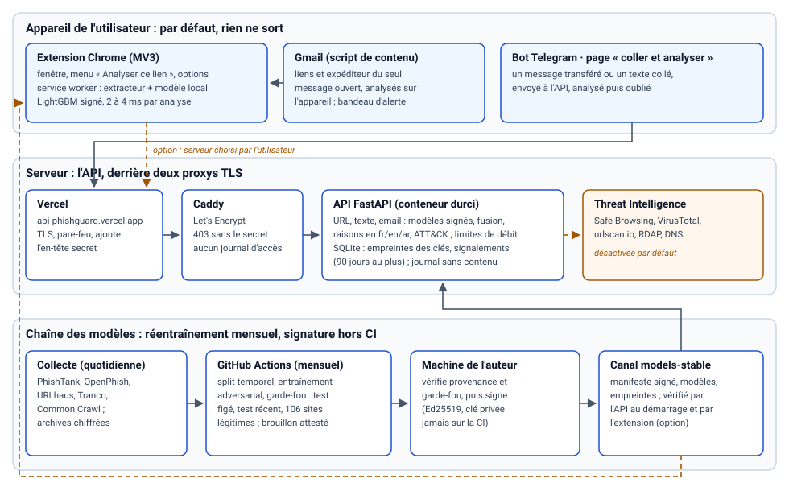

# Architecture

PhishGuard a trois façons d'être utilisé (l'extension, le bot Telegram, la page « coller
et analyser ») et un principe : **analyser au plus près de l'utilisateur**. L'extension
juge les adresses sur l'appareil, sans réseau ; l'API ne sert qu'aux canaux qui n'ont pas
de calcul local, ou à l'utilisateur qui la demande expressément.

*Traits pleins : flux toujours actifs. Pointillés orange : options désactivées par
défaut.*

## Sur l'appareil de l'utilisateur

| Composant | Rôle | Détails |
| --- | --- | --- |
| Extension Chrome (Manifest V3) | analyse l'adresse de l'onglet ou d'un lien, sur l'appareil, avec le **même** extracteur, le même modèle et la même règle de décision que l'API, portés en TypeScript et vérifiés contre Python (200 vecteurs de référence, fuzzing différentiel) | [conception](extension-design.md), [données](extension-privacy.md) |
| Script de contenu Gmail | lit les liens et l'expéditeur du **seul** message ouvert, affiche un bandeau dans un Shadow DOM fermé, ne modifie aucun lien | [conception](extension-design.md) |
| Mises à jour du modèle (option) | télécharge et vérifie un modèle signé, au plus une fois par jour | [mises à jour](model-updates.md#4-côté-extension) |

## Sur le serveur

| Composant | Rôle | Détails |
| --- | --- | --- |
| Vercel | nom public gratuit, TLS, pare-feu ; relaie vers l'origine en ajoutant un en-tête secret | [déploiement](deployment.md) |
| Caddy | TLS vers l'origine, refuse en 403 toute requête sans le secret, aucun journal d'accès | [déploiement](deployment.md) |
| API FastAPI | analyse d'URL, de texte et d'email (`.eml`) : modèles signés, fusion du score, raisons lisibles, techniques ATT&CK ; limites de débit, schémas stricts, journal sans contenu | [API](api.md), [fusion](fusion.md), [schéma de réponse](response-schema.md) |
| Threat Intelligence (option du serveur) | Safe Browsing, VirusTotal, urlscan.io, RDAP, DNS ; un enrichisseur ne lève jamais d'exception, l'analyse locale continue sans lui | [enrichisseurs](enrichers.md), [SSRF](ssrf.md) |
| Bot Telegram | transmet un message transféré à l'API, répond en texte brut, ne garde rien | [bot](telegram-bot.md) |
| Page « coller et analyser » | page statique servie par l'API, CSP stricte, Trusted Types | [page web](web-page.md) |

## Chaîne des modèles

| Étape | Où | Détails |
| --- | --- | --- |
| collecte quotidienne des flux de phishing et des listes légitimes | GitHub Actions, archives chiffrées | [sources](data-sources.md), [jeu d'URLs](url-dataset.md) |
| split temporel et groupé par domaine | Python | [split](split.md) |
| entraînement, calibration, entraînement adversarial | Python (LightGBM, scikit-learn) | [modèles URL](url-models.md), [robustesse](robustness-report.md) |
| réentraînement mensuel et garde-fou de non-régression | GitHub Actions | [mises à jour](model-updates.md) |
| signature Ed25519 du manifeste | machine de l'auteur, jamais la CI | [registre](model-registry.md) |
| export JSON pour l'extension (sans pickle) | Python, vérifié par une implémentation de référence | [export](model-export.md) |

## Choix structurants

- **Le serveur ne visite jamais l'URL analysée.** Toutes les features sont lexicales :
  pas de requête vers un site potentiellement hostile, pas de SSRF possible par
  construction ([ssrf.md](ssrf.md)).
- **Un seul contrat de réponse**, figé et versionné, pour l'API, l'extension et le bot
  ([schéma](response-schema.md)).
- **Un modèle est une donnée signée, pas du code** pour l'extension (JSON vérifié nœud par
  nœud) ; pour l'API, un pickle n'est désérialisé qu'après vérification de son empreinte
  signée.
- **Des mesures honnêtes** : split temporel, faux positifs suivis autant que le rappel,
  robustesse face à l'évasion publiée avec ses échecs
  ([évaluation](evaluation.md), [rapport de robustesse](robustness-report.md)).

Les menaces prises en compte et leurs parades : [modèle de menace](threat-model.md).
