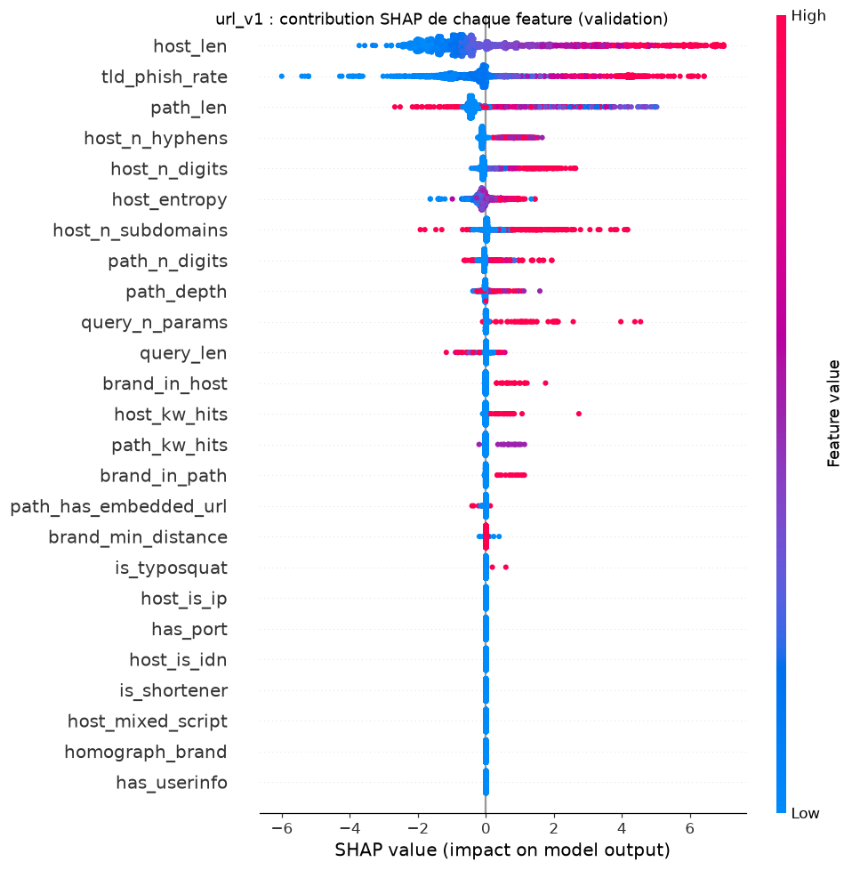

# Explications SHAP du modèle URL

*Étape 3.1 du cahier des charges. Code : `src/phishguard/explain/shap_url.py`. Script : `scripts/explain_url.py` (`make explain-url`). Tests : `tests/test_explain_shap_url.py`.*

Un score seul ne dit pas **pourquoi** une URL est jugée dangereuse. Cette page montre ce qui fait monter ou baisser le score du modèle `url_v1`, d'abord en moyenne sur la validation, puis pour des URLs une par une. Les phrases destinées à l'utilisateur viennent à l'étape 3.2 ; ici, on parle features.

## La méthode

Pour une URL, la **valeur SHAP** d'une feature est sa part dans l'écart entre le score de cette URL et le score moyen du modèle (Lundberg et Lee, 2017). Elle vient de la théorie des jeux : chaque feature reçoit sa contribution moyenne sur tous les ordres possibles d'ajout des features. Pour des arbres, l'algorithme TreeSHAP la calcule **exactement**, sans échantillonnage.

Les parts s'additionnent :

```
score brut = valeur de base + somme des valeurs SHAP
probabilité = sigmoïde(score brut)
```

Le score brut est en **log-odds**, l'espace dans lequel les arbres de LightGBM s'additionnent. Une valeur positive pousse vers « phishing », une valeur négative vers « légitime ». Une contribution de +1 multiplie la cote du phishing par e ≈ 2,7.

```python
from phishguard.explain.shap_url import UrlExplainer
from phishguard.urls.model import UrlModel

explainer = UrlExplainer(UrlModel.load("models/url_v1.joblib"))
explanation = explainer.explain_one("http://paypa1-secure.example/login")
explanation.top(3)  # les 3 features qui ont le plus poussé vers « phishing »
explanation.probability  # égale au score du modèle
```

### Deux moteurs, les mêmes valeurs

| Moteur | Quand | Coût |
| --- | --- | --- |
| LightGBM natif (`predict(..., pred_contrib=True)`) | `url_v1` et tout modèle LightGBM | aucune dépendance de plus, environ 10 ms par URL |
| Bibliothèque `shap` (`TreeExplainer`) | autres modèles d'arbres (Random Forest) | `pip install -e '.[explain]'` |

LightGBM implémente lui-même TreeSHAP. Sur 200 URLs de validation, l'écart entre les deux moteurs est de **0,0** : ce sont les mêmes calculs. L'analyse en ligne (API, module 4) n'a donc pas besoin de la bibliothèque `shap`, qui n'est utilisée que pour le graphique ci-dessous. Un test vérifie l'égalité à chaque exécution.

### Le piège des formes

Selon la version de `shap` et le modèle, les valeurs reviennent :

- en liste de deux tableaux, un par classe (anciennes versions) ;
- en tableau à trois dimensions `(URLs, features, classes)` (versions récentes) ;
- en un seul tableau `(URLs, features)` ;
- avec la valeur de base en dernière colonne (`pred_contrib` de LightGBM).

Indexer sans vérifier donne des valeurs fausses sans erreur : la classe « légitime » au lieu de « phishing », ou la valeur de base prise pour une feature. `normalize_shap_values` ramène les quatre formes à une matrice `(URLs, features)` de la classe phishing et lève une erreur pour toute autre forme. Les tests couvrent chacune.

## Vue globale



Chaque point est une URL. Sa position horizontale est la contribution de la feature à son score, sa couleur la valeur de la feature (rouge : élevée, bleu : faible).

<!-- generated:explain-url:start -->
*Généré par `scripts/explain_url.py` depuis [`metrics/url_v1_shap.json`](metrics/url_v1_shap.json) : modèle `url_v1` (SHA-256 `9aa07df2ec23`), jeu `0310e419432c`, 2 000 URLs de validation tirées au hasard (graine 0). Valeurs SHAP en log-odds, calculées par LightGBM (TreeSHAP natif).*

### Importance globale

Moyenne de la valeur absolue SHAP sur l'échantillon : de combien, en moyenne, la feature déplace le score d'une URL, dans un sens ou dans l'autre.

| Rang | Feature | Moyenne de \|SHAP\| | Part | Ce qu'elle mesure |
| ---: | :--- | ---: | ---: | :--- |
| 1 | `host_len` | 1,598 | 36,8 % | caractères de l'hôte (forme Unicode) |
| 2 | `tld_phish_rate` | 1,021 | 23,5 % | part de phishing du TLD à l'entraînement, lissée (voir phishguard.urls.tld) |
| 3 | `path_len` | 0,584 | 13,4 % | caractères du chemin brut |
| 4 | `host_n_hyphens` | 0,252 | 5,8 % | tirets dans l'hôte (forme Unicode) |
| 5 | `host_n_digits` | 0,214 | 4,9 % | chiffres dans l'hôte (forme Unicode) |
| 6 | `host_entropy` | 0,204 | 4,7 % | entropie de Shannon des caractères de l'hôte (bits) |
| 7 | `host_n_subdomains` | 0,196 | 4,5 % | labels avant le domaine enregistré, sans un « www » initial |
| 8 | `path_n_digits` | 0,075 | 1,7 % | chiffres dans le chemin et la requête décodés |
| 9 | `path_depth` | 0,057 | 1,3 % | segments non vides du chemin |
| 10 | `query_n_params` | 0,049 | 1,1 % | paramètres non vides de la requête |
| 11 | `query_len` | 0,026 | 0,6 % | caractères de la requête brute |
| 12 | `brand_in_host` | 0,018 | 0,4 % | 1 si un label de l'hôte (hors suffixe) contient une marque dont ce n'est pas le domaine officiel |
| 13 | `host_kw_hits` | 0,016 | 0,4 % | mots-clés de KEYWORDS présents dans l'hôte |
| 14 | `path_kw_hits` | 0,016 | 0,4 % | mots-clés présents dans le chemin et la requête décodés |
| 15 | `brand_in_path` | 0,013 | 0,3 % | 1 si le chemin ou la requête décodés contiennent une marque dont l'hôte n'est pas le domaine officiel |
| 16 | `path_has_embedded_url` | 0,004 | 0,1 % | 1 si le chemin ou la requête décodés contiennent « http: », « https: » ou « www. » |
| 17 | `brand_min_distance` | 0,002 | 0,1 % | distance de Levenshtein entre le label du domaine et la marque la plus proche dont ce n'est pas le domaine officiel, plafonnée à BRAND_DISTANCE_CAP |
| 18 | `is_typosquat` | 0,001 | 0,0 % | 1 si le label du domaine est à 1 modification d'une marque (2 pour un nom d'au moins 9 caractères), sans être la marque elle-même |
| 19 | `host_is_ip` | 0,000 | 0,0 % | 1 si l'hôte est une adresse IPv6 ou se termine par un nombre (IPv4, y compris décimal ou hexadécimal, règle WHATWG) |
| 20 | `has_port` | 0,000 | 0,0 % | 1 si un port différent du port par défaut est indiqué |
| 21 | `host_is_idn` | 0,000 | 0,0 % | 1 si l'hôte contient un label internationalisé |
| 22 | `is_shortener` | 0,000 | 0,0 % | 1 si l'hôte ou son domaine enregistré est un raccourcisseur connu |
| 23 | `has_userinfo` | 0,000 | 0,0 % | 1 si l'URL contient des identifiants avant l'hôte (@) |
| 24 | `homograph_brand` | 0,000 | 0,0 % | 1 si l'hôte est internationalisé et que son squelette visuel contient une marque absente de sa forme réelle |
| 25 | `host_mixed_script` | 0,000 | 0,0 % | 1 si un label mêle des écritures non admises ensemble (UTS #39, Highly Restrictive) |

### 10 URLs de phishing détectées et leurs 3 raisons principales

Seuil de décision `fpr_0_5pct` (score > 0,8263), réglé sur la validation à l'étape 1.7. Chaque raison est notée `feature` = valeur (contribution SHAP). Exemples défangés et sans requête ; données de phishing fournies par PhishTank, phishtank.org.

| URL | Score | Raison 1 | Raison 2 | Raison 3 |
| :--- | ---: | :--- | :--- | :--- |
| `hxxps://c1ientebrada[.]blob[.]core[.]windows[.]net/dir/index.html` | 0,983 | `host_len` = 34 (+4,59) | `path_len` = 15 (+2,66) | `host_n_subdomains` = 0 (+0,63) |
| `hxxps://fatturapagamento[.]click/.submit/unpaid.php` | 0,999 | `tld_phish_rate` = 0,78 (+3,53) | `path_len` = 19 (+2,28) | `host_len` = 22 (+1,64) |
| `hxxps://vigilance89[.]github[.]io/vigilane8viewdocument/` | 0,995 | `path_len` = 23 (+2,13) | `host_len` = 21 (+1,71) | `tld_phish_rate` = 0,30 (+1,36) |
| `hxxps://allegro[.]3299g88g2909[.]pl/` | 0,923 | `host_n_subdomains` = 1 (+3,06) | `host_len` = 23 (+2,30) | `host_n_digits` = 10 (+1,78) |
| `hxxps://suitetrezorio[.]com/?…` | 0,850 | `query_n_params` = 2 (+3,83) | `path_n_digits` = 45 (+1,94) | `brand_in_host` = 1 (+0,68) |
| `hxxps://allegro[.]102988g8g8g[.]pl/lokalnie/?…` | 0,921 | `host_n_digits` = 8 (+2,14) | `query_n_params` = 1 (+1,12) | `host_len` = 22 (+1,06) |
| `hxxps://url6131[.]picsello[.]com/ls/click?…` | 0,978 | `path_n_digits` = 94 (+2,79) | `path_len` = 9 (+1,51) | `query_n_params` = 1 (+1,27) |
| `hxxps://bradesco[.]habilitanetempresabr[.]pro/` | 0,999 | `host_len` = 33 (+4,30) | `tld_phish_rate` = 0,61 (+2,47) | `host_n_subdomains` = 1 (+1,84) |
| `hxxps://luciana[.]acces2675277[.]pro/as.php` | 0,998 | `tld_phish_rate` = 0,61 (+2,44) | `host_n_digits` = 7 (+1,99) | `host_len` = 24 (+1,84) |
| `hxxps://techbazaronline[.]co[.]uk/des` | 0,833 | `path_len` = 4 (+3,77) | `host_n_subdomains` = 0 (+0,90) | `host_len` = 21 (+0,86) |
<!-- generated:explain-url:end -->

## Lecture

Critère de l'étape : **pour 10 URLs, nommer les 3 raisons principales, et elles ont du sens.** Les 10 exemples ci-dessus ont chacun trois raisons ; la plupart se lisent comme un analyste les écrirait, et trois révèlent ce que le modèle a appris des données plutôt que du phishing.

**Ce qui a du sens.**

- `allegro[.]3299g88g2909[.]pl` et `bradesco[.]habilitanetempresabr[.]pro` : une **marque en sous-domaine** d'un domaine sans rapport, un hôte long et chargé de chiffres, un TLD très présent dans le phishing (`.pro`, 61 % de phishing à l'entraînement). C'est le schéma classique de l'usurpation.
- `fatturapagamento[.]click/.submit/unpaid.php` (« paiement de facture ») : TLD `.click` (78 % de phishing), page `.php` au nom d'impayé. `suitetrezorio[.]com` : la marque Trezor dans l'hôte (`brand_in_host`).
- `c1ientebrada[.]blob[.]core[.]windows[.]net` : un hôte de 34 caractères sur un service de stockage, où `c1iente` imite `cliente` avec un chiffre. Le modèle ne connaît pas Bradesco sous cette forme, mais la longueur suffit.

**Ce qui révèle les données.**

- **`host_len` pèse 37 % de l'importance globale.** C'est le biais de popularité déjà mesuré à l'étape 1.5 ([`url-features.md`](url-features.md#lecture)) : les domaines du haut de Tranco sont courts. SHAP le rend visible URL par URL : les points bleus (hôte court) poussent tous vers « légitime ».
- **Un chemin court mais non vide pousse vers « phishing ».** `techbazaronline[.]co[.]uk/des` est jugé phishing d'abord parce que son chemin fait 4 caractères (+3,77). Les pages d'accueil légitimes ont le chemin `/` et les pages internes Common Crawl de longs chemins : un chemin de 2 à 20 caractères n'existe presque que dans le phishing. C'est le biais de chemin de l'étape 1.3 ([`data-bias.md`](data-bias.md)), affaibli mais pas supprimé.
- **Une valeur nulle peut être une raison.** `host_n_subdomains = 0` pousse vers « phishing » pour l'URL sur `windows.net`. Seul, ce n'est pas un indice (17 % de phishing à l'entraînement), mais avec un hôte long, si : parmi les hôtes de 30 caractères ou plus, ceux sans sous-domaine sont à 99 % du phishing, car la longueur est alors celle du nom de domaine lui-même. SHAP répartit cette interaction entre les deux features. Une raison SHAP mesure un écart à la moyenne, pas la présence d'un indice.
- **Les features de marque et d'homographe pèsent presque zéro.** Elles se déclenchent rarement (moins de 5 % du phishing) et LightGBM retrouve l'essentiel par la longueur, les tirets et les chiffres. Leur importance globale est faible, mais quand elles se déclenchent, ce sont les raisons les plus parlantes pour un utilisateur.

**Conséquence pour l'étape 3.2.** On ne peut pas traduire mot pour mot les trois plus fortes contributions : « le chemin fait 4 caractères » ou « l'hôte n'a pas de sous-domaine » ne sont pas des raisons qu'un utilisateur peut vérifier, et elles reflètent en partie les biais des données. Les phrases ne retiendront que les features **compréhensibles et dont la valeur est en elle-même un indice** (une marque dans l'hôte, un TLD à risque, une adresse IP), classées par leur contribution SHAP.

## Limites

- **SHAP explique le modèle, pas le monde.** Une contribution forte dit ce que le modèle a appris, y compris ses biais : si `tld_phish_rate` pèse lourd, c'est que les TLD sont très inégalement représentés dans les données (voir [`data-bias.md`](data-bias.md)).
- **Contribution n'est pas causalité.** Des features corrélées (longueur et nombre de chiffres de l'hôte, par exemple) se partagent le crédit d'une même information, d'une façon qui dépend des arbres appris.
- **Log-odds, pas points de score.** Une même contribution SHAP déplace beaucoup la probabilité près de 0,5, et très peu près de 0 ou 1. Les points affichés à l'utilisateur (étape 3.2) sont recalculés dans l'espace du score.
- **L'explication porte sur le score brut**, avant la calibration de l'étape 2.10. La calibration isotone est croissante : elle ne change pas l'ordre des raisons.
