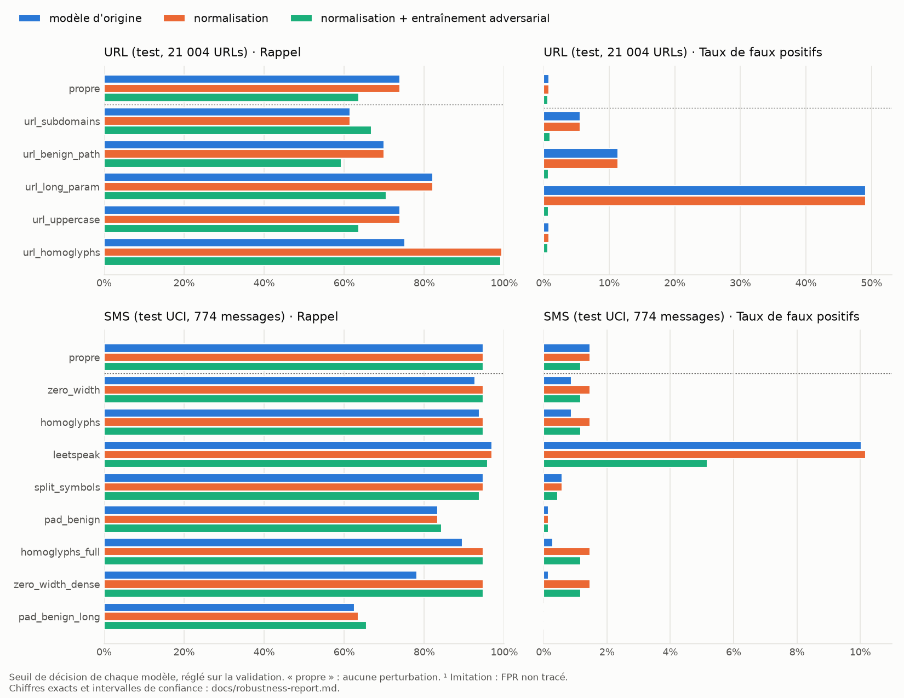

# Rapport de robustesse

*Module 3 du cahier des charges, étapes 3.5 à 3.11. Code :*

- *`src/phishguard/adversarial/perturb.py` : les perturbations ;*
- *`src/phishguard/adversarial/benchmark.py` : les mesures ;*
- *`src/phishguard/adversarial/augment.py` : l'entraînement adversarial ;*
- *`src/phishguard/security/normalize.py` : la normalisation ;*
- *scripts `robustness_benchmark.py`, `train_adversarial.py`, `evaluate_llm_phishing.py` et `plot_robustness.py`.*

*Tests : `tests/test_adversarial_perturb.py`, `test_robustness_benchmark.py`, `test_security_normalize.py`, `test_adversarial_augment.py`, `test_llm_phishing.py`. Techniques mesurées : [evasion-catalog.md](evasion-catalog.md).*

Ce rapport mesure ce que gagne un attaquant qui modifie la forme de ses leurres sans en changer le sens, puis ce que lui retirent deux défenses. Les chiffres sont ceux des modèles réels, sur les jeux de test réels, **même quand ils sont mauvais** : c'est leur raison d'être.

## En bref

- **Les évasions de caractères ne passent plus.** Homoglyphes, caractères invisibles, pleine chasse : la normalisation (NFKC, retrait des caractères de format, repli des confusables) ramène le message perturbé au message propre. Sous une largeur nulle entre chaque lettre, le rappel SMS remonte de 78,1 % à 94,8 %, c'est-à-dire à celui du texte propre. Un homographe d'hôte (`аpple.com`) est signalé dans 99,4 % des cas au lieu de 75,1 %.
- **Les évasions de forme ne paient presque plus, et ne déclenchent plus de fausses alertes.** Après entraînement adversarial (sur les deux classes, avec un générateur que le banc ne connaît pas), un long paramètre de suivi ne fait plus signaler 49 % des URLs légitimes, mais 0,8 %. Sous l'évasion la plus efficace contre le modèle d'origine (sous-domaines), le nouveau modèle détecte plus : 66,9 % contre 61,4 %.
- **La robustesse a un prix, et il est mesuré.** Le modèle URL robuste perd 10,3 points de rappel sur les URLs propres. Une partie du rappel d'origine venait d'un raccourci (pas de chemin = légitime) que le jeu de test, biaisé comme l'entraînement, récompense.
- **La dilution reste la meilleure attaque contre le texte.** 50 mots anodins font encore perdre 29 points de rappel au modèle SMS : le TF-IDF normalise la longueur.
- **Contre du phishing rédigé par un LLM, le texte seul ne suffit plus, dans l'autre sens.** Le rappel tient (90 %), mais 57 à 63 % des courriers légitimes d'entreprise sont signalés, et la ROC-AUC tombe de 0,99 à 0,71. Ce qui reste discriminant ne dépend pas de la rédaction : l'âge et la réputation du domaine, la concordance du lien et l'authentification de l'expéditeur.

*Rappel (à gauche) et taux de faux positifs (à droite) sous chaque perturbation, au seuil de décision de chaque modèle. Bleu : modèle d'origine ; orange : normalisation ; vert : normalisation + entraînement adversarial. Graphique produit par `scripts/plot_robustness.py` ; chiffres exacts dans les [tableaux](#6-résultats-après-défenses).*

## 1. Modèle de menace

Celui du [catalogue des évasions](evasion-catalog.md#modèle-de-menace), dont chaque technique porte sa référence MITRE ATLAS (AML.T0015 *Evade AI Model*, AML.T0043 *Craft Adversarial Data*) et ATT&CK.

- **Attaquant** : un opérateur de campagne de phishing ou de smishing. Il teste ses leurres contre PhishGuard autant qu'il veut, en **boîte noire** (AML.T0042 *Verify Attack*). Il n'a ni le modèle, ni ses poids, ni ses données d'entraînement.
- **Contrainte** : la modification doit **garder l'effet sur la victime**. Une URL perturbée mène au même serveur, un message perturbé se lit de la même façon. C'est ce qui sépare une évasion d'un bruit.
- **Ce que l'attaquant gagne** : du rappel en moins (son leurre passe). **Ce que le défenseur risque** : des faux positifs en plus. Une défense qui signale toute forme inhabituelle rend le détecteur inutilisable.
- **Hors périmètre** : l'empoisonnement des données d'entraînement, le vol du modèle par requêtes et les attaques contre l'API (module 4).

## 2. Méthodologie

- **Perturbations** : dix techniques du catalogue, implémentées à l'étape 3.6. Elles sont appliquées une à la fois, avec une graine fixe (0) et une graine propre à chaque échantillon (CRC32, stable d'une machine à l'autre). Les réglages modérés ont été fixés **avant** toute mesure. Trois variantes à intensité maximale (`homoglyphs_full`, `zero_width_dense`, `pad_benign_long`) ont été ajoutées après le premier passage, qui montrait que les réglages modérés touchaient peu le modèle SMS. Elles sont signalées comme telles.
- **Ce qui est perturbé** : tous les échantillons, phishing **et** légitimes. Un échantillon où la technique ne s'applique pas (une URL sur une adresse IP n'a pas de sous-domaine) reste dans le calcul, inchangé. La colonne « Phishing modifié » des tableaux donne la part réellement touchée.
- **Mesures** : au seuil de décision de chaque modèle, réglé sur la validation. Aucun seuil n'est réglé sur le test.
  - **rappel** du phishing perturbé, et son écart au rappel d'origine (**Δ rappel**) : ce que gagne l'attaquant ;
  - **taux de faux positifs** du légitime perturbé de la même façon (**Δ FPR**) ;
  - **échappés** : phishing détecté sans perturbation, manqué avec ;
  - intervalles de Wilson à 95 % pour chaque taux.
- **Imitations** : une URL légitime dont l'hôte est réécrit en homoglyphes désigne un autre domaine. La signaler est juste, et son « FPR » (note ¹) ne mesure pas de fausses alertes. Il est exclu du FPR sous perturbation des résumés et du graphique.
- **Un passage par défense** : `baseline` (modèles d'origine), `normalization` (défense 1) et `adversarial` (défenses 1 et 2), sur les mêmes jeux et avec les mêmes perturbations. Une ablation (`adversarial_phishing_only`) mesure la variante écartée de la défense 2.
- **Pas de triche à l'entraînement** : le générateur de l'entraînement adversarial n'a aucun vocabulaire en commun avec celui du banc, ni la même graine (vérifié par les tests). Sinon, le banc mesurerait la mémoire du modèle et non sa robustesse.
- **Reproduire** (les modèles ne sont pas versionnés) :
  - `make robustness` rejoue `baseline`. Le modèle SMS d'origine, remplacé à l'étape 3.8, se rejoue avec `--text-model models/baseline/text_v1.joblib` (copie locale) ;
  - `scripts/robustness_benchmark.py --label normalization --url-host-rule` rejoue la défense 1 ;
  - `make train-adversarial robustness-adversarial` rejoue la défense 2 ;
  - l'ablation se rejoue avec `scripts/train_adversarial.py --classes phishing --version-suffix _phishing_only` vers `models/ablation/`, puis le banc sur ces modèles ;
  - enfin, `make llm-phishing` et `make plot-robustness`.

## 3. Jeux de données

| Jeu | Taille | Rôle | Remarques |
| --- | ---: | --- | --- |
| URL, bloc de test de l'étape 1.4 | 21 004 (4 200 phishing) | modèle URL | le plus récent dans le temps, aucun domaine commun avec l'entraînement ; légitime fait de pages d'accueil Tranco et de pages internes Common Crawl ([data-bias.md](data-bias.md)) |
| SMS Spam Collection, bloc de test | 774 (96 spams) | modèle SMS | même dédoublonnage et même split groupé par gabarit que `train_text.py` ; la classe positive est le spam, dont le smishing n'est qu'une partie |
| SMS français / arabe | 100 (50 frauduleux) | hors distribution | `datasets/sms_fr_ar.csv`, jamais vu à l'entraînement ; intervalles larges |
| Phishing rédigé par un LLM | 300 (150 phishing) | dégradation face à des messages sans faute | local, jamais versionné ([llm-phishing.md](llm-phishing.md)) ; domaines réservés seulement |
| Contrôle « légitime avec lien » | 40 | faux positifs des règles fondées sur les liens | ajouté après la première mesure, signalé comme tel |

## 4. Résultats avant défenses

### Mesures

<!-- generated:robustness-baseline:start -->
*Généré par `scripts/robustness_benchmark.py` le 2026-11-09, passage `baseline` : modèles d'origine, avant toute défense. Graine des perturbations : 0. Intervalles de Wilson à 95 % entre crochets ; « Échappés » : phishing détecté sans perturbation, manqué avec. Chiffres complets : [`metrics/robustness_baseline.json`](metrics/robustness_baseline.json).*

#### URL (test)

Modèle `url_v1` (`9aa07df2ec23`), seuil `fpr_0_5pct` (score > 0,8263), 4 200 URLs de phishing et 16 804 légitimes.

| Perturbation | Technique | Phishing modifié | Rappel | Δ rappel | FPR | Δ FPR | Échappés |
| :--- | :--- | ---: | ---: | ---: | ---: | ---: | ---: |
| *aucune* |  |  | 73,9 % [72,6–75,2 %] |  | 0,83 % [0,71–0,98 %] |  |  |
| `url_subdomains` | URL-03 | 100 % | 61,4 % [59,9–62,9 %] | **−12,5 pts** | 5,56 % [5,22–5,91 %] | +4,73 pts | 676 |
| `url_benign_path` | URL-04 | 100 % | 70,0 % [68,6–71,4 %] | **−3,9 pts** | 11,34 % [10,87–11,83 %] | +10,51 pts | 433 |
| `url_long_param` | URL-06 | 100 % | 82,2 % [81,0–83,3 %] | **+8,3 pts** | 49,14 % [48,38–49,89 %] | +48,30 pts | 126 |
| `url_uppercase` | URL-07 | 100 % | 73,9 % [72,6–75,2 %] | **±0,0 pts** | 0,83 % [0,71–0,98 %] | ±0,00 pts | 0 |
| `url_homoglyphs` | URL-02 | 98 % | 75,1 % [73,8–76,4 %] | **+1,2 pts** | 1,02 % [0,88–1,18 %] | +0,18 pts | 40 |

Pire perturbation : `url_subdomains` (URL-03), −12,5 pts de rappel ; 676 phishing détectés sans perturbation passent.

#### SMS (test UCI, anglais)

Modèle `text_v1` (`d583ba3f3e3a`), seuil `decision` (score > -0,2538), 96 spams et 678 légitimes.

| Perturbation | Technique | Phishing modifié | Rappel | Δ rappel | FPR | Δ FPR | Échappés |
| :--- | :--- | ---: | ---: | ---: | ---: | ---: | ---: |
| *aucune* |  |  | 94,8 % [88,4–97,8 %] |  | 1,47 % [0,80–2,69 %] |  |  |
| `zero_width` | TXT-02 | 100 % | 92,7 % [85,7–96,4 %] | **−2,1 pts** | 0,88 % [0,41–1,92 %] | −0,59 pts | 2 |
| `homoglyphs` | TXT-01 | 100 % | 93,8 % [87,0–97,1 %] | **−1,0 pts** | 0,88 % [0,41–1,92 %] | −0,59 pts | 2 |
| `leetspeak` | TXT-04 | 99 % | 96,9 % [91,2–98,9 %] | **+2,1 pts** | 10,03 % [7,99–12,52 %] | +8,55 pts | 0 |
| `split_symbols` | TXT-03 | 99 % | 94,8 % [88,4–97,8 %] | **±0,0 pts** | 0,59 % [0,23–1,51 %] | −0,88 pts | 0 |
| `pad_benign` | TXT-05 | 100 % | 83,3 % [74,6–89,5 %] | **−11,5 pts** | 0,15 % [0,03–0,83 %] | −1,33 pts | 11 |
| `homoglyphs_full` | TXT-01 | 100 % | 89,6 % [81,9–94,2 %] | **−5,2 pts** | 0,29 % [0,08–1,07 %] | −1,18 pts | 5 |
| `zero_width_dense` | TXT-02 | 100 % | 78,1 % [68,9–85,2 %] | **−16,7 pts** | 0,15 % [0,03–0,83 %] | −1,33 pts | 16 |
| `pad_benign_long` | TXT-05 | 100 % | 62,5 % [52,5–71,5 %] | **−32,3 pts** | 0,00 % [0,00–0,56 %] | −1,47 pts | 31 |

Pire perturbation : `pad_benign_long` (TXT-05), −32,3 pts de rappel ; 31 phishing détectés sans perturbation passent.

#### SMS français / arabe (hors distribution)

Modèle `text_v1` (`d583ba3f3e3a`), seuil `decision` (score > -0,2538), 50 messages frauduleux et 50 légitimes.

| Perturbation | Technique | Phishing modifié | Rappel | Δ rappel | FPR | Δ FPR | Échappés |
| :--- | :--- | ---: | ---: | ---: | ---: | ---: | ---: |
| *aucune* |  |  | 70,0 % [56,2–80,9 %] |  | 42,00 % [29,37–55,77 %] |  |  |
| `zero_width` | TXT-02 | 100 % | 70,0 % [56,2–80,9 %] | **±0,0 pts** | 46,00 % [32,97–59,60 %] | +4,00 pts | 3 |
| `homoglyphs` | TXT-01 | 86 % | 70,0 % [56,2–80,9 %] | **±0,0 pts** | 38,00 % [25,86–51,85 %] | −4,00 pts | 2 |
| `leetspeak` | TXT-04 | 86 % | 82,0 % [69,2–90,2 %] | **+12,0 pts** | 66,00 % [52,15–77,56 %] | +24,00 pts | 1 |
| `split_symbols` | TXT-03 | 100 % | 64,0 % [50,1–75,9 %] | **−6,0 pts** | 24,00 % [14,30–37,41 %] | −18,00 pts | 3 |
| `pad_benign` | TXT-05 | 100 % | 2,0 % [0,4–10,5 %] | **−68,0 pts** | 0,00 % [0,00–7,14 %] | −42,00 pts | 34 |
| `homoglyphs_full` | TXT-01 | 86 % | 58,0 % [44,2–70,6 %] | **−12,0 pts** | 42,00 % [29,37–55,77 %] | ±0,00 pts | 7 |
| `zero_width_dense` | TXT-02 | 100 % | 28,0 % [17,5–41,7 %] | **−42,0 pts** | 20,00 % [11,24–33,04 %] | −22,00 pts | 21 |
| `pad_benign_long` | TXT-05 | 100 % | 0,0 % [0,0–7,1 %] | **−70,0 pts** | 0,00 % [0,00–7,14 %] | −42,00 pts | 35 |

Pire perturbation : `pad_benign_long` (TXT-05), −70,0 pts de rappel ; 35 phishing détectés sans perturbation passent.
<!-- generated:robustness-baseline:end -->

### Lecture

#### URL : le modèle a appris la forme des URLs de son jeu, dans les deux sens

- **Les sous-domaines ajoutés sont l'évasion la plus efficace** : −12,5 points de rappel, et 676 phishing détectés passent. `url_v1` associe un hôte court et sans sous-domaine au phishing (étape 3.1 : « 0 sous-domaine » est une raison quand l'hôte est long). Deux labels anodins (`support.`, `fr.`) suffisent à déplacer l'URL vers le légitime, alors que l'attaquant les crée gratuitement sur son propre domaine.
- **Le chemin bénin gagne peu en rappel (−3,9 points), mais fait exploser les faux positifs** (+10,5 points) : les pages d'accueil légitimes à qui l'on ajoute un chemin deviennent suspectes. C'est le biais de chemin mesuré dès l'étape 1.3, vu sous un autre angle : le modèle ne juge pas le chemin, il juge sa présence.
- **Un long paramètre de suivi fait signaler près d'une URL légitime sur deux** (FPR de 0,83 % à 49,1 %). Il ne sert donc pas l'attaquant : le rappel monte de 8,3 points. Mais les liens d'emailing légitimes portent justement de longs paramètres `utm_*`. C'est un **risque de faux positifs en production**, plus qu'une évasion, et il faudra le corriger (étape 3.9).
- **La casse de l'hôte ne change rien** (Δ nul, aucun échappé) : l'hôte est mis en minuscules avant les features. C'était attendu, et c'est le test de non-régression de la normalisation.
- **Les homographes ne trompent pas le modèle** : le rappel monte de 1,2 point, grâce aux features `host_mixed_script` et `homograph_brand` de l'étape 1.5. 40 phishing passent quand même. Ici, le « FPR » est trompeur : une URL légitime dont l'hôte est réécrit en cyrillique n'est plus le site légitime, c'en est une imitation, et la signaler est juste.

#### SMS : les n-grammes de caractères résistent, la dilution non

- **Aux réglages modérés, homoglyphes et largeur nulle coûtent peu** (−1,0 et −2,1 points). Un n-gramme de 2 à 5 caractères survit si la lettre remplacée n'en fait pas partie, et le spam a beaucoup d'autres indices (numéros surtaxés, montants, « call », « free »). C'était l'argument du choix de `char_wb` à l'étape 1.9, et il tient.
- **À intensité maximale, ils coûtent cher** : une largeur nulle entre toutes les lettres fait perdre 16,7 points de rappel, et le remplacement de toutes les lettres possibles en fait perdre 5,2. Pour le lecteur, le message est identique. Ce sont exactement les cas que la normalisation de l'étape 3.8 doit annuler.
- **La dilution est l'attaque la plus forte** : 20 mots anodins font perdre 11,5 points de rappel, 50 mots en font perdre 32,3. Le TF-IDF est normalisé : chaque mot ajouté réduit le poids des n-grammes suspects, et ces mots ont des coefficients négatifs. La normalisation n'y peut rien. Les catégories de leurre (lien, code, argent), qui ne dépendent pas de la longueur, et l'entraînement adversarial (3.9) sont les pistes.
- **Le leetspeak augmente les faux positifs** (+8,55 points), plus qu'il n'aide l'attaquant : le modèle a appris que les chiffres signalent le spam (numéros, montants, codes). Un message légitime « c0mpte » est rare. Le même mécanisme expliquerait des faux positifs sur des messages légitimes riches en chiffres (horaires, références).
- **Couper les mots par des points ne change pas le rappel.** Les n-grammes qui contiennent `.` existent déjà dans le spam (URLs, abréviations).

#### SMS français / arabe : déjà fragile sans perturbation

Le modèle, entraîné sur de l'anglais, signale 42 % des messages légitimes français et arabes avant toute perturbation. C'était déjà connu depuis l'étape 1.9. Sous dilution par des mots anglais anodins, le rappel tombe à 2 %, puis à 0 % : les mots anglais pèsent plus que tout ce que le modèle sait lire du message. Sur 100 messages, les intervalles de confiance sont larges, mais la conclusion ne dépend pas de quelques points. **Sans données d'entraînement en français et en arabe, aucune défense de ce module ne rendra le modèle fiable dans ces langues.**

### Ce que les défenses doivent viser

| Faiblesse mesurée | Perturbations | Défense prévue |
| --- | --- | --- |
| caractères différents, même lecture | `homoglyphs_full`, `zero_width_dense`, `zero_width`, `homoglyphs` | normalisation Unicode et repli des confusables (3.8) |
| hôte en écritures mêlées | `url_homoglyphs` | règle explicite d'alerte (3.8), en plus des features existantes |
| forme de l'URL (sous-domaines, chemin, requête) | `url_subdomains`, `url_benign_path`, `url_long_param` | entraînement adversarial (3.9) ; la normalisation n'y peut rien |
| dilution du texte | `pad_benign`, `pad_benign_long` | entraînement adversarial (3.9), catégories de leurre |
| chiffres pris pour un indice de spam | `leetspeak` | entraînement adversarial (3.9) |

## 5. Défenses

### 5.1 Normalisation (étape 3.8)

La normalisation ([normalization.md](normalization.md)) ramène l'entrée à ce qu'elle montre, à l'entraînement comme à l'inférence :

- NFKC, puis retrait des caractères de format et de contrôle ;
- repli des homoglyphes pour le texte ;
- pour les hôtes, une règle d'alerte au lieu d'un repli.

Le modèle SMS a été réentraîné avec la normalisation dans son vectoriseur. Le modèle URL est inchangé : sur les 98 031 URLs d'entraînement, une seule est modifiée par la normalisation. Ce passage lui ajoute la règle d'alerte des hôtes, appliquée comme une alerte forte : un hôte qui imite des lettres latines est signalé quel que soit le score.

### 5.2 Entraînement adversarial (étape 3.9)

Les évasions de forme (sous-domaines, chemin, paramètre, dilution, leetspeak) ne changent aucun caractère que la normalisation pourrait replier. Le modèle doit apprendre qu'elles ne changent pas la nature d'un leurre. L'entraînement adversarial ([`adversarial/augment.py`](../src/phishguard/adversarial/augment.py), `make train-adversarial`) ajoute au **seul bloc d'entraînement** une copie perturbée de chaque échantillon, avec la même étiquette, puis réentraîne **la configuration déjà retenue** de chaque modèle (même famille, mêmes hyperparamètres, mêmes features, même graine). Seule la donnée change.

- **Un générateur que le banc ne connaît pas.** Le banc mesurerait sinon la mémoire du modèle, pas sa robustesse. Les techniques sont les mêmes (ce sont celles des attaquants), mais le générateur d'entraînement a ses propres vocabulaires (mots de remplissage, sous-domaines, segments de chemin, noms de paramètres, tous disjoints de ceux du banc, ce que vérifient les tests), ses propres séparateurs (`-`, `_`, `*` au lieu de `.`), sa propre table leet (`@`, `$`, `!`…), des intensités tirées au hasard dans une plage au lieu d'un réglage fixe, et sa propre graine (3009, contre 0 pour le banc).
- **Ni la validation ni le test ne sont augmentés.** Les seuils sont réglés sur la validation propre, comme à l'origine. Les copies d'URL gardent leur domaine enregistré, et le split de l'étape 1.4 est groupé par domaine : aucune copie ne fuit vers un autre bloc.
- **Les deux classes sont perturbées.** C'était un choix fait avant toute mesure : copier le phishing seul (la lecture littérale du plan) apprend au modèle que la forme ajoutée **signale** le phishing, alors qu'un lien légitime d'emailing porte lui aussi de longs paramètres `utm_*`. L'ablation de la section 6 le confirme.
- **Techniques exclues** : homoglyphes, largeur nulle et casse, que la normalisation annule avant le modèle (leurs copies seraient identiques aux originaux), et homographes d'hôte, qui fabriquent un autre domaine.

<!-- generated:adversarial-training:start -->
*Généré par `scripts/train_adversarial.py` le 2026-11-09 : générateur d'entraînement 1.0.0, graine 3009, 1 copie(s) par échantillon, classes perturbées : phishing et légitime. Chiffres complets : [`metrics/adversarial_training.json`](metrics/adversarial_training.json).*

| Modèle | Version | Entraînement | Copies phishing / légitime | Recettes | PR-AUC validation | R@1%FPR validation |
| :--- | :--- | ---: | ---: | :--- | ---: | ---: |
| URL | `url_v1` → `url_v2` | 98 031 | 19 599 / 78 432 | `subdomains` 32 657, `benign_path` 32 716, `long_param` 32 658 | 0,956 → 0,938 | 0,841 → 0,767 |
| SMS | `text_v1` → `text_v2` | 3 612 | 450 / 3 162 | `pad_words` 1 281, `leet_symbols` 1 150, `split_dashes` 1 181 | 0,993 → 0,994 | 0,979 → 0,969 |
<!-- generated:adversarial-training:end -->

## 6. Résultats après défenses

### Résumé : l'effet de chaque défense

<!-- generated:robustness-summary:start -->
*Généré par `scripts/robustness_benchmark.py`. « Sous perturbation » : moyenne et pire cas sur toutes les perturbations du bloc ; le FPR sous perturbation exclut celles qui fabriquent une imitation (note ¹).*

#### URL (test)

| Passage | Rappel propre | FPR propre | Rappel moyen sous perturbation | Pire rappel | Pire FPR sous perturbation |
| :--- | ---: | ---: | ---: | ---: | ---: |
| `baseline` (modèle d'origine) | 73,9 % | 0,83 % | 72,5 % | 61,4 % (`url_subdomains`) | 49,14 % (`url_long_param`) |
| `normalization` (normalisation seule) | 73,9 % | 0,83 % | 77,4 % | 61,4 % (`url_subdomains`) | 49,14 % (`url_long_param`) |
| `adversarial` (normalisation + entraînement adversarial) | 63,6 % | 0,68 % | 71,9 % | 59,2 % (`url_benign_path`) | 0,96 % (`url_subdomains`) |
| `adversarial_phishing_only` (ablation : augmentation du phishing seul) | 69,7 % | 0,60 % | 84,7 % | 69,7 % (`url_uppercase`) | 94,03 % (`url_long_param`) |

#### SMS (test UCI, anglais)

| Passage | Rappel propre | FPR propre | Rappel moyen sous perturbation | Pire rappel | Pire FPR sous perturbation |
| :--- | ---: | ---: | ---: | ---: | ---: |
| `baseline` (modèle d'origine) | 94,8 % | 1,47 % | 86,5 % | 62,5 % (`pad_benign_long`) | 10,03 % (`leetspeak`) |
| `normalization` (normalisation seule) | 94,8 % | 1,47 % | 89,7 % | 63,5 % (`pad_benign_long`) | 10,18 % (`leetspeak`) |
| `adversarial` (normalisation + entraînement adversarial) | 94,8 % | 1,18 % | 89,8 % | 65,6 % (`pad_benign_long`) | 5,16 % (`leetspeak`) |
| `adversarial_phishing_only` (ablation : augmentation du phishing seul) | 93,8 % | 1,62 % | 83,6 % | 27,1 % (`pad_benign_long`) | 40,86 % (`leetspeak`) |

#### SMS français / arabe (hors distribution)

| Passage | Rappel propre | FPR propre | Rappel moyen sous perturbation | Pire rappel | Pire FPR sous perturbation |
| :--- | ---: | ---: | ---: | ---: | ---: |
| `baseline` (modèle d'origine) | 70,0 % | 42,00 % | 46,8 % | 0,0 % (`pad_benign_long`) | 66,00 % (`leetspeak`) |
| `normalization` (normalisation seule) | 70,0 % | 42,00 % | 53,5 % | 0,0 % (`pad_benign_long`) | 64,00 % (`leetspeak`) |
| `adversarial` (normalisation + entraînement adversarial) | 66,0 % | 36,00 % | 49,8 % | 0,0 % (`pad_benign_long`) | 62,00 % (`leetspeak`) |
| `adversarial_phishing_only` (ablation : augmentation du phishing seul) | 82,0 % | 58,00 % | 63,2 % | 0,0 % (`pad_benign`) | 80,00 % (`leetspeak`) |
<!-- generated:robustness-summary:end -->

### Rappel et faux positifs par perturbation

<!-- generated:robustness-comparison:start -->
*Généré par `scripts/robustness_benchmark.py` à partir de `robustness_baseline.json`, `robustness_normalization.json`, `robustness_adversarial.json`. Rappel et FPR au seuil de décision de chaque modèle.*

#### URL (test)

| Perturbation | Rappel `baseline` | FPR `baseline` | Rappel `normalization` | FPR `normalization` | Rappel `adversarial` | FPR `adversarial` |
| :--- | ---: | ---: | ---: | ---: | ---: | ---: |
| *aucune* | 73,9 % | 0,83 % | 73,9 % | 0,83 % | 63,6 % | 0,68 % |
| `url_subdomains` | 61,4 % | 5,56 % | 61,4 % | 5,56 % | 66,9 % | 0,96 % |
| `url_benign_path` | 70,0 % | 11,34 % | 70,0 % | 11,34 % | 59,2 % | 0,71 % |
| `url_long_param` | 82,2 % | 49,14 % | 82,2 % | 49,14 % | 70,5 % | 0,77 % |
| `url_uppercase` | 73,9 % | 0,83 % | 73,9 % | 0,83 % | 63,6 % | 0,68 % |
| `url_homoglyphs` | 75,1 % | 1,02 % | 99,4 % | 97,22 % | 99,2 % | 97,23 % |

#### SMS (test UCI, anglais)

| Perturbation | Rappel `baseline` | FPR `baseline` | Rappel `normalization` | FPR `normalization` | Rappel `adversarial` | FPR `adversarial` |
| :--- | ---: | ---: | ---: | ---: | ---: | ---: |
| *aucune* | 94,8 % | 1,47 % | 94,8 % | 1,47 % | 94,8 % | 1,18 % |
| `zero_width` | 92,7 % | 0,88 % | 94,8 % | 1,47 % | 94,8 % | 1,18 % |
| `homoglyphs` | 93,8 % | 0,88 % | 94,8 % | 1,47 % | 94,8 % | 1,18 % |
| `leetspeak` | 96,9 % | 10,03 % | 96,9 % | 10,18 % | 95,8 % | 5,16 % |
| `split_symbols` | 94,8 % | 0,59 % | 94,8 % | 0,59 % | 93,8 % | 0,44 % |
| `pad_benign` | 83,3 % | 0,15 % | 83,3 % | 0,15 % | 84,4 % | 0,15 % |
| `homoglyphs_full` | 89,6 % | 0,29 % | 94,8 % | 1,47 % | 94,8 % | 1,18 % |
| `zero_width_dense` | 78,1 % | 0,15 % | 94,8 % | 1,47 % | 94,8 % | 1,18 % |
| `pad_benign_long` | 62,5 % | 0,00 % | 63,5 % | 0,00 % | 65,6 % | 0,00 % |

#### SMS français / arabe (hors distribution)

| Perturbation | Rappel `baseline` | FPR `baseline` | Rappel `normalization` | FPR `normalization` | Rappel `adversarial` | FPR `adversarial` |
| :--- | ---: | ---: | ---: | ---: | ---: | ---: |
| *aucune* | 70,0 % | 42,00 % | 70,0 % | 42,00 % | 66,0 % | 36,00 % |
| `zero_width` | 70,0 % | 46,00 % | 70,0 % | 42,00 % | 66,0 % | 36,00 % |
| `homoglyphs` | 70,0 % | 38,00 % | 70,0 % | 42,00 % | 66,0 % | 36,00 % |
| `leetspeak` | 82,0 % | 66,00 % | 82,0 % | 64,00 % | 80,0 % | 62,00 % |
| `split_symbols` | 64,0 % | 24,00 % | 64,0 % | 24,00 % | 52,0 % | 22,00 % |
| `pad_benign` | 2,0 % | 0,00 % | 2,0 % | 0,00 % | 2,0 % | 0,00 % |
| `homoglyphs_full` | 58,0 % | 42,00 % | 70,0 % | 42,00 % | 66,0 % | 36,00 % |
| `zero_width_dense` | 28,0 % | 20,00 % | 70,0 % | 42,00 % | 66,0 % | 36,00 % |
| `pad_benign_long` | 0,0 % | 0,00 % | 0,0 % | 0,00 % | 0,0 % | 0,00 % |
<!-- generated:robustness-comparison:end -->

### Après la normalisation

- **Les évasions de caractères sont annulées.** Sous homoglyphes et largeur nulle, à intensité modérée comme maximale, le rappel SMS revient **exactement** à celui du texte propre (94,8 %). `zero_width_dense` passait de 94,8 % à 78,1 % ; il ne coûte plus rien. Le message perturbé et le message propre donnent le même texte normalisé, donc le même score : c'est une garantie, pas une moyenne.
- **Le jeu français / arabe en profite aussi** : sous `zero_width_dense`, le rappel remonte de 28 % à 70 %, et de 58 % à 70 % sous `homoglyphs_full`.
- **Les homographes d'hôte sont presque tous signalés** : 99,4 % de rappel au lieu de 75,1 %. Toutes les URLs réécrites déclenchent l'alerte. Les 27 phishing encore manqués sont des URLs que la perturbation n'a pas pu modifier (adresse IP, aucune lettre remplaçable). Le « FPR » de 97 % de cette ligne mesure des imitations, pas des fausses alertes (note ¹).
- **Aucun faux positif de plus sur les données propres** : FPR de 0,83 % (URL) et 1,47 % (SMS), comme avant. La règle d'alerte ne se déclenche sur aucune URL légitime du test. Sous `zero_width` et `homoglyphs`, le FPR du légitime perturbé passe de 0,88 % à 1,47 % : il ne monte pas, il **redevient** celui du texte propre. La perturbation faisait baisser le score des messages légitimes, et la normalisation l'annule dans les deux sens.
- **Les évasions de forme sont intactes**, comme prévu : sous-domaines (−12,5 points), chemin bénin, long paramètre, dilution (−31,2 points avec 50 mots), leetspeak. La normalisation ne les visait pas. Elles sont la cible de l'entraînement adversarial (étape 3.9).
- **Coût** : la normalisation est écrite en Python, caractère par caractère. Elle fait passer la latence du modèle SMS de 0,53 ms à 1,25 ms par message (p50, [text-models.md](text-models.md)). C'est négligeable pour un message, et à surveiller pour l'analyse par lots.

### Après l'entraînement adversarial

- **URL : les faux positifs sous perturbation de forme disparaissent.** Un long paramètre de suivi faisait signaler 49,1 % des URLs légitimes ; c'est 0,77 % avec `url_v2`. Le chemin bénin passe de 11,3 % à 0,71 %, les sous-domaines de 5,6 % à 0,96 %. Le FPR sous perturbation est désormais celui des URLs propres (0,68 %) : le modèle ne juge plus la présence d'un chemin ou d'une requête. C'était le principal risque de production relevé par le premier passage, puisque les liens d'emailing légitimes portent ces paramètres.
- **L'attaquant ne gagne presque plus rien à changer la forme.** Sous perturbation, le rappel reste entre 59,2 % et 70,5 % pour un rappel propre de 63,6 %. Sous l'évasion la plus efficace contre `url_v1` (sous-domaines), `url_v2` détecte **plus** (66,9 % contre 61,4 %).
- **Le prix : 10,3 points de rappel sur les URLs propres** (73,9 % → 63,6 %, à un FPR plus bas : 0,68 % contre 0,83 %). Sur la validation, la PR-AUC passe de 0,956 à 0,938. Une partie du rappel de `url_v1` venait donc de la forme des URLs, qui sépare aussi le phishing du légitime **dans ce jeu** : le légitime est fait en grande partie de pages d'accueil Tranco sans chemin ([data-bias.md](data-bias.md)). Le test partage ce biais, et il récompense le raccourci que l'entraînement adversarial retire. Ce qui reste est plus honnête, et c'est ce qu'un attaquant ne peut pas contourner en ajoutant `support.` devant son hôte.
- **SMS : un gain sans coût.** Rappel propre identique (94,8 %), FPR propre plus bas (1,47 % → 1,18 %). Le leetspeak fait moitié moins de faux positifs (10,2 % → 5,2 %) : le modèle a appris que des chiffres à la place des lettres ne suffisent pas à faire un spam.
- **La dilution résiste.** 50 mots anodins font encore perdre 29,2 points (rappel 65,6 % contre 63,5 % avant). Le TF-IDF normalise la longueur : chaque mot ajouté réduit le poids des n-grammes suspects, quel que soit l'entraînement. Et les mots du banc ne sont pas ceux de l'entraînement, par construction : le modèle ne peut pas apprendre à les reconnaître. Les catégories de leurre (lien, code, argent), qui ne dépendent pas de la longueur, semblaient la piste suivante ; la section 7 montre qu'elles ne séparent pas un leurre d'un courrier d'entreprise. La piste restante est une défense dédiée (pistes futures, point 4).
- **Le français et l'arabe ne sont pas réparés.** FPR de 42 % à 36 %, rappel de 70 % à 66 %, sur 100 messages. La conclusion de la section « avant défenses » tient : sans données d'entraînement dans ces langues, aucune défense de ce module ne suffit.

**L'ablation confirme le choix des deux classes.** Même générateur, mêmes réglages, mais seul le phishing est copié (`--classes phishing`), avec des modèles jamais déployés (tableaux en [annexe](#annexe--tableaux-détaillés-par-passage)). Copier le phishing seul fait monter le rappel moyen sous perturbation (84,7 % pour les URLs), mais parce que le modèle signale désormais **toute** forme ajoutée : 94 % des URLs légitimes avec un paramètre de suivi, 40,9 % des SMS légitimes en leetspeak. C'est le contraire d'une défense. Côté SMS, la dilution devient même pire (rappel de 27,1 % sous `pad_benign_long`) : sans copies légitimes, le modèle apprend probablement les mots du générateur d'entraînement comme indices de spam, et ceux du banc, qu'il n'a jamais vus, gardent leur poids légitime.

**Déploiement (étape 3.12).** `text_v2` remplace `text_v1` : il fait mieux ou aussi bien partout. Pour les URLs, le choix est un compromis : `url_v2` perd du rappel sur un test biaisé, mais supprime une évasion gratuite et un risque de faux positifs massif en production. **`url_v2` est déployé** (`src/phishguard/deployment.py`, [analysis.md](analysis.md#les-modèles-déployés-étape-312)). La Threat Intelligence compense une partie du rappel perdu, et le choix se réverse en une ligne si les mesures en production le contredisent.

## 7. Phishing rédigé par un LLM (étape 3.10)

Un LLM rédige un leurre sans faute, au ton juste, dans le style d'un vrai service client. Les détecteurs qui comptent sur les fautes, les majuscules ou le vocabulaire du spam y perdent leurs indices. Ce chapitre mesure ce que deviennent les modèles SMS face à ces messages, et face à des courriers professionnels légitimes **aussi bien écrits**.

- **Jeu défensif et local** ([llm-phishing.md](llm-phishing.md)) : 150 messages de phishing et 150 messages légitimes d'entreprise, rédigés par un LLM (Claude), en anglais comme le corpus d'entraînement. Il y a 15 familles par classe et la moitié des messages sont des SMS. Les organisations sont fictives et partagées par les deux classes, les liens ne pointent que vers des domaines réservés (`example.com`, `.test`) et le jeu ne contient aucune coordonnée réelle. Le chargeur refuse tout fichier qui enfreint ces règles. Le jeu n'est pas versionné : il ne sort pas de la machine. Seuls son empreinte et les mesures sont publiés.
- **Contrôle ajouté après la première mesure** : 40 messages légitimes qui contiennent tous un lien (relevé, confirmation d'adresse, suivi de colis, document partagé). Le premier passage a montré que seuls 5 % des messages légitimes du jeu principal avaient un lien, contre 85 % du phishing : une règle fondée sur les liens y paraissait précise pour une raison de construction. Le jeu principal n'a pas été modifié, et le contrôle est signalé comme tel.
- **Mesures** au seuil de décision réglé sur la validation SMS, sans aucun réglage sur ce jeu. La règle de leurre (lien **et** demande de code ou de compte) est fixée à l'avance : ce sont les constats que l'analyse relie déjà à ATT&CK T1598.

<!-- generated:llm-phishing:start -->
*Généré par `scripts/evaluate_llm_phishing.py` le 2026-11-09, jeu `2647d5e6785c` : 150 phishing et 150 légitimes, 30 familles, 151 SMS et 149 emails. Seuil de décision de chaque modèle, intervalles de Wilson à 95 %. Chiffres complets : [`metrics/llm_phishing.json`](metrics/llm_phishing.json).*

#### Dégradation

| Modèle | Rappel SMS (UCI) | Rappel LLM | Δ rappel | FPR SMS (UCI) | FPR LLM | Δ FPR | ROC-AUC SMS → LLM |
| :--- | ---: | ---: | ---: | ---: | ---: | ---: | ---: |
| `text_v1` | 94,8 % [88,4–97,8 %] | 91,3 % [85,7–94,9 %] | −3,5 pts | 1,47 % [0,80–2,69 %] | 62,67 % [54,70–70,00 %] | **+61,2 pts** | 0,992 → 0,709 |
| `text_v2` | 94,8 % [88,4–97,8 %] | 90,0 % [84,2–93,8 %] | −4,8 pts | 1,18 % [0,60–2,31 %] | 57,33 % [49,33–64,97 %] | **+56,2 pts** | 0,992 → 0,720 |

#### Par canal

| Modèle | Canal | Rappel | FPR |
| :--- | :--- | ---: | ---: |
| `text_v1` | email | 93,3 % [85,3–97,1 %] | 75,68 % [64,79–84,02 %] |
| `text_v1` | sms | 89,3 % [80,3–94,5 %] | 50,00 % [39,03–60,97 %] |
| `text_v2` | email | 90,7 % [82,0–95,4 %] | 68,92 % [57,66–78,31 %] |
| `text_v2` | sms | 89,3 % [80,3–94,5 %] | 46,05 % [35,31–57,18 %] |

#### Par famille

Rappel pour une famille de phishing, FPR pour une famille légitime (10 messages chacune).

| Famille | Classe | `text_v1` | `text_v2` |
| :--- | :--- | ---: | ---: |
| `account_suspended` | phishing | 90 % | 80 % |
| `bank_fraud_alert` | phishing | 100 % | 100 % |
| `document_share` | phishing | 100 % | 100 % |
| `gift_card_ceo` | phishing | 30 % | 30 % |
| `investment` | phishing | 90 % | 90 % |
| `invoice_payment` | phishing | 100 % | 100 % |
| `it_mailbox` | phishing | 90 % | 90 % |
| `job_offer` | phishing | 100 % | 90 % |
| `mfa_code` | phishing | 90 % | 90 % |
| `parcel_fee` | phishing | 100 % | 100 % |
| `password_expiry` | phishing | 100 % | 100 % |
| `payroll_update` | phishing | 80 % | 80 % |
| `prize_reward` | phishing | 100 % | 100 % |
| `subscription_renewal` | phishing | 100 % | 100 % |
| `tax_refund` | phishing | 100 % | 100 % |
| `appointment` | légitime | 70 % | 60 % |
| `colleague_message` | légitime | 20 % | 20 % |
| `customer_service` | légitime | 60 % | 60 % |
| `delivery_update` | légitime | 80 % | 80 % |
| `hr_announcement` | légitime | 40 % | 20 % |
| `invoice_available` | légitime | 80 % | 80 % |
| `it_maintenance` | légitime | 50 % | 50 % |
| `meeting_reminder` | légitime | 60 % | 40 % |
| `newsletter` | légitime | 70 % | 50 % |
| `order_confirmation` | légitime | 80 % | 80 % |
| `otp_code` | légitime | 90 % | 90 % |
| `password_changed` | légitime | 60 % | 60 % |
| `payroll_available` | légitime | 70 % | 70 % |
| `security_notice` | légitime | 50 % | 40 % |
| `travel` | légitime | 60 % | 60 % |

#### Catégories de leurre

Part des messages où chaque catégorie est repérée (`explain.text.message_categories`).

| Catégorie | Phishing | Légitime | Contrôle (légitime avec lien) |
| :--- | ---: | ---: | ---: |
| urgence | 19 % | 1 % | 0 % |
| argent | 25 % | 16 % | 0 % |
| lien | 85 % | 5 % | 100 % |
| code | 16 % | 13 % | 15 % |
| compte | 63 % | 37 % | 52 % |

#### Ce qui compense

Règle de leurre fixée avant la mesure : **lien et demande de code ou de compte**. Ensemble : signalé par le modèle **ou** par la règle. Verdict : celui de l'analyse complète (`TextAnalyzer`, fusion), suspect ou phishing. Scénario d'infrastructure : signal RDAP « domaine de 3 jours » ajouté aux liens du phishing, le légitime n'étant pas modifié. Contrôle : 40 messages légitimes **avec lien**, ajoutés après la première mesure (voir la lecture).

| Signal | Modèle | Rappel LLM | FPR LLM | FPR SMS (UCI) | FPR contrôle |
| :--- | :--- | ---: | ---: | ---: | ---: |
| règle seule |  | 52,7 % [44,7–60,5 %] | 2,00 % [0,68–5,71 %] | 0,00 % [0,00–0,56 %] | 52,5 % [37,5–67,1 %] |
| modèle seul | `text_v1` | 91,3 % [85,7–94,9 %] | 62,67 % [54,70–70,00 %] | 1,47 % [0,80–2,69 %] | 90,0 % [76,9–96,0 %] |
| modèle + règle | `text_v1` | 92,0 % [86,5–95,4 %] | 62,67 % [54,70–70,00 %] | 1,47 % [0,80–2,69 %] | 92,5 % [80,1–97,4 %] |
| verdict de l'analyse | `text_v1` | 76,0 % [68,6–82,1 %] | 43,33 % [35,67–51,33 %] |  | 70,0 % [54,6–81,9 %] |
| verdict + domaine récent (scénario) | `text_v1` | 92,0 % [86,5–95,4 %] | 43,33 % [35,67–51,33 %] |  | 70,0 % [54,6–81,9 %] |
| modèle seul | `text_v2` | 90,0 % [84,2–93,8 %] | 57,33 % [49,33–64,97 %] | 1,18 % [0,60–2,31 %] | 87,5 % [73,9–94,5 %] |
| modèle + règle | `text_v2` | 90,7 % [84,9–94,4 %] | 57,33 % [49,33–64,97 %] | 1,18 % [0,60–2,31 %] | 90,0 % [76,9–96,0 %] |
| verdict de l'analyse | `text_v2` | 78,7 % [71,4–84,5 %] | 43,33 % [35,67–51,33 %] |  | 82,5 % [68,0–91,3 %] |
| verdict + domaine récent (scénario) | `text_v2` | 90,7 % [84,9–94,4 %] | 43,33 % [35,67–51,33 %] |  | 82,5 % [68,0–91,3 %] |

85 % du phishing LLM contient un lien. Avec `text_v1`, 12 phishing que l'analyse ne signale pas n'en ont aucun : aucun signal d'infrastructure de lien ne peut les rattraper.
<!-- generated:llm-phishing:end -->

### Lecture

- **La dégradation n'est pas là où on l'attendait.** Le rappel tient : 90 à 91 % du phishing LLM est signalé, contre 94,8 % du spam UCI. Ce qui s'effondre, ce sont les **faux positifs** : 57 à 63 % des courriers légitimes d'entreprise sont signalés, contre 1,2 à 1,5 % des SMS légitimes du test. La ROC-AUC passe de 0,99 à 0,71. Le modèle ne sépare plus les classes, quel que soit le seuil.
- **Pourquoi** : le légitime de la SMS Spam Collection est fait de messages personnels (« ok see you at 7 »). Le modèle a appris « ton commercial ou transactionnel = spam ». Un code de connexion, une facture disponible, un avis de livraison : 80 à 90 % sont signalés. Ce n'est pas un détecteur de phishing, c'est un détecteur de message d'entreprise. Une mauvaise orthographe n'a jamais été son indice principal. Le registre l'était, et un LLM l'imite parfaitement dans les deux sens.
- **Le phishing qu'il manque est celui qui n'a ni lien ni montant** : faux dirigeant et cartes cadeaux (30 % de rappel), demandes de virement « confidentielles ». Ce sont des leurres conversationnels, sans aucun mot de spam.
- **`text_v2` fait un peu mieux** (FPR de 57 % contre 63 %, ROC-AUC de 0,72 contre 0,71) : l'entraînement adversarial lui a appris que des chiffres et des symboles ne suffisent pas. C'est un écart dans les intervalles de confiance, et il ne change pas la conclusion.
- **La règle de leurre ne compense pas.** Sur le jeu principal, « lien et demande de code ou de compte » semble excellente : 52,7 % de rappel pour 2 % de FPR. Le contrôle montre que c'était un artefact : elle signale 52,5 % des messages légitimes avec un lien. Un relevé « disponible dans votre compte » et un leurre « vérifiez votre compte » ont les mêmes catégories. L'ensemble modèle + règle n'apporte presque rien (+0,7 point de rappel) et ajoute des faux positifs sur le contrôle. Cette règle **ne sera pas** ajoutée à la fusion (étape 3.12).
- **Ce qui compense, ce sont les signaux d'infrastructure, et seulement pour le rappel.** Avec un domaine de 3 jours sur le lien, l'analyse signale 92 % du phishing au lieu de 76 % (`text_v1`). C'est un scénario : le jeu n'a que des domaines réservés, et il ne dit pas combien de leurres réels utilisent un domaine récent. Il montre ce que la fusion ferait du signal. Deux limites restent :
  - le signal ne rattrape pas les 12 phishing sans lien ;
  - **il ne fait pas baisser les faux positifs** : la fusion du module 2 ne fait qu'ajouter du risque, et un domaine ancien n'innocente pas un message. Avec 43 % de verdicts suspects sur les courriers légitimes, le texte seul n'est pas utilisable sur des messages professionnels.
- **Conclusion.** Face à des messages bien écrits, le texte seul ne suffit plus, dans les deux sens : il ne distingue plus un leurre d'un vrai courrier. Ce qui reste discriminant ne dépend pas de la rédaction :
  - la concordance du lien avec l'expéditeur annoncé ;
  - l'âge et la réputation du domaine (module 2) ;
  - l'authentification de l'expéditeur pour l'email (SPF, DKIM, DMARC, étape 1.10).

  Le modèle SMS doit aussi être réentraîné sur des messages d'entreprise légitimes. Sans ces données, son verdict sur un message professionnel est à prendre comme un indice faible, et les clients devront le présenter ainsi (module 5).

## 8. Limites

- **Perturbations écrites à la main, une à la fois.** Elles reproduisent des techniques connues, avec des réglages fixés. Un attaquant les combine, et peut chercher automatiquement les mots qui font basculer le verdict (AML.T0043.001). Aucune attaque automatisée n'a été lancée : TextAttack, optionnel à l'étape 3.7, demande PyTorch, et le modèle SMS est un SVM sur des caractères, sans gradients exploitables. Une recherche en boîte noire coûterait des milliers de requêtes par message. Les chiffres de ce rapport sont donc une **borne optimiste** de la robustesse.
- **Un seul seuil.** Les mesures sont faites au seuil de décision. Le décalage moyen du score, dans les JSON, donne une idée de l'effet loin du seuil.
- **Les jeux portent leurs biais.** Le légitime URL est fait de pages d'accueil et de pages internes, sans liens d'emailing réels. Le FPR sous `url_long_param` simule ces liens, il ne les mesure pas. Le test URL récompense aussi le raccourci de forme que la défense 2 retire : la perte de rappel de `url_v2` est en partie un artefact du jeu, mais rien ne permet de dire quelle part.
- **Le SMS n'est pas le phishing.** La classe positive de la SMS Spam Collection est le spam. Le jeu français / arabe ne compte que 100 messages, et le jeu LLM a un seul rédacteur, en anglais, avec 10 messages par famille.
- **Le scénario d'infrastructure n'est pas une mesure.** Les liens du jeu LLM sont sur des domaines réservés : le gain d'un « domaine récent » montre ce que ferait la fusion, pas la fréquence de ce signal sur des leurres réels.
- **La fusion ne fait qu'ajouter du risque.** Aucun signal de confiance ne peut aujourd'hui faire baisser un faux positif du modèle texte.

## 9. Pistes futures

1. **Mesurer en production** (module 4). Depuis l'étape 3.12, la normalisation, l'alerte d'hôte (règle dure `lookalike_host`) et les modèles robustes sont dans le pipeline principal. Il reste à vérifier sur du trafic réel, sans rien conserver de personnel, que `url_v2` tient ses promesses.
2. **Des données légitimes d'entreprise pour le modèle texte.** C'est la faiblesse la plus coûteuse mesurée ici (57 à 63 % de FPR sur des courriers professionnels). Les retours des utilisateurs (étape 4.10) en sont la source naturelle, à condition de ne rien conserver de personnel.
3. **Des signaux de confiance dans la fusion** : expéditeur authentifié (SPF, DKIM, DMARC alignés), domaine ancien et concordant avec la marque annoncée. Ce sont des signaux capables de **baisser** un score, ce que la fusion actuelle ne sait pas faire.
4. **Une défense dédiée à la dilution** : score par fenêtres glissantes, ou maximum sur les phrases du message plutôt qu'un TF-IDF du message entier. Des mots ajoutés à la fin ne pourraient plus noyer la phrase suspecte.
5. **Des attaques automatisées et combinées** : une recherche gloutonne en boîte noire sur les mots (AML.T0043.001) et des combinaisons de perturbations, pour remplacer la borne optimiste de ce rapport par une estimation plus réaliste.
6. **Surveiller l'empoisonnement** : les flux publics de phishing (étape 1.1) alimentent l'entraînement. Un contrôle de dérive des sources à chaque collecte (étape 6.8) limiterait le risque.

## Annexe : tableaux détaillés par passage

### Passage `normalization`

<!-- generated:robustness-normalization:start -->
*Généré par `scripts/robustness_benchmark.py` le 2026-11-09, passage `normalization` : normalisation de l'étape 3.8 : SMS réentraîné avec NFKC, invisibles retirés et homoglyphes repliés ; règle d'alerte des hôtes qui imitent le latin. Graine des perturbations : 0. Intervalles de Wilson à 95 % entre crochets ; « Échappés » : phishing détecté sans perturbation, manqué avec. Chiffres complets : [`metrics/robustness_normalization.json`](metrics/robustness_normalization.json).*

#### URL (test)

Modèle `url_v1` (`9aa07df2ec23`), seuil `fpr_0_5pct` (score > 0,8263), 4 200 URLs de phishing et 16 804 légitimes.

| Perturbation | Technique | Phishing modifié | Rappel | Δ rappel | FPR | Δ FPR | Échappés |
| :--- | :--- | ---: | ---: | ---: | ---: | ---: | ---: |
| *aucune* |  |  | 73,9 % [72,6–75,2 %] |  | 0,83 % [0,71–0,98 %] |  |  |
| `url_subdomains` | URL-03 | 100 % | 61,4 % [59,9–62,9 %] | **−12,5 pts** | 5,56 % [5,22–5,91 %] | +4,73 pts | 676 |
| `url_benign_path` | URL-04 | 100 % | 70,0 % [68,6–71,4 %] | **−3,9 pts** | 11,34 % [10,87–11,83 %] | +10,51 pts | 433 |
| `url_long_param` | URL-06 | 100 % | 82,2 % [81,0–83,3 %] | **+8,3 pts** | 49,14 % [48,38–49,89 %] | +48,30 pts | 126 |
| `url_uppercase` | URL-07 | 100 % | 73,9 % [72,6–75,2 %] | **±0,0 pts** | 0,83 % [0,71–0,98 %] | ±0,00 pts | 0 |
| `url_homoglyphs` | URL-02 | 98 % | 99,4 % [99,1–99,6 %] | **+25,5 pts** | 97,22 % [96,96–97,46 %] ¹ | +96,39 pts | 0 |

¹ La perturbation fabrique une imitation : une URL légitime réécrite en homoglyphes désigne un autre domaine, et la signaler est juste. Ce FPR ne mesure pas de fausses alertes.

Règle d'alerte de l'étape 3.8 appliquée : un hôte qui imite des lettres latines est signalé quel que soit le score du modèle.

Pire perturbation : `url_subdomains` (URL-03), −12,5 pts de rappel ; 676 phishing détectés sans perturbation passent.

#### SMS (test UCI, anglais)

Modèle `text_v1` (`0b93f67b536e`), seuil `decision` (score > -0,2532), 96 spams et 678 légitimes.

| Perturbation | Technique | Phishing modifié | Rappel | Δ rappel | FPR | Δ FPR | Échappés |
| :--- | :--- | ---: | ---: | ---: | ---: | ---: | ---: |
| *aucune* |  |  | 94,8 % [88,4–97,8 %] |  | 1,47 % [0,80–2,69 %] |  |  |
| `zero_width` | TXT-02 | 100 % | 94,8 % [88,4–97,8 %] | **±0,0 pts** | 1,47 % [0,80–2,69 %] | ±0,00 pts | 0 |
| `homoglyphs` | TXT-01 | 100 % | 94,8 % [88,4–97,8 %] | **±0,0 pts** | 1,47 % [0,80–2,69 %] | ±0,00 pts | 0 |
| `leetspeak` | TXT-04 | 99 % | 96,9 % [91,2–98,9 %] | **+2,1 pts** | 10,18 % [8,12–12,68 %] | +8,70 pts | 0 |
| `split_symbols` | TXT-03 | 99 % | 94,8 % [88,4–97,8 %] | **±0,0 pts** | 0,59 % [0,23–1,51 %] | −0,88 pts | 0 |
| `pad_benign` | TXT-05 | 100 % | 83,3 % [74,6–89,5 %] | **−11,5 pts** | 0,15 % [0,03–0,83 %] | −1,33 pts | 11 |
| `homoglyphs_full` | TXT-01 | 100 % | 94,8 % [88,4–97,8 %] | **±0,0 pts** | 1,47 % [0,80–2,69 %] | ±0,00 pts | 0 |
| `zero_width_dense` | TXT-02 | 100 % | 94,8 % [88,4–97,8 %] | **±0,0 pts** | 1,47 % [0,80–2,69 %] | ±0,00 pts | 0 |
| `pad_benign_long` | TXT-05 | 100 % | 63,5 % [53,6–72,5 %] | **−31,2 pts** | 0,00 % [0,00–0,56 %] | −1,47 pts | 30 |

Pire perturbation : `pad_benign_long` (TXT-05), −31,2 pts de rappel ; 30 phishing détectés sans perturbation passent.

#### SMS français / arabe (hors distribution)

Modèle `text_v1` (`0b93f67b536e`), seuil `decision` (score > -0,2532), 50 messages frauduleux et 50 légitimes.

| Perturbation | Technique | Phishing modifié | Rappel | Δ rappel | FPR | Δ FPR | Échappés |
| :--- | :--- | ---: | ---: | ---: | ---: | ---: | ---: |
| *aucune* |  |  | 70,0 % [56,2–80,9 %] |  | 42,00 % [29,37–55,77 %] |  |  |
| `zero_width` | TXT-02 | 100 % | 70,0 % [56,2–80,9 %] | **±0,0 pts** | 42,00 % [29,37–55,77 %] | ±0,00 pts | 0 |
| `homoglyphs` | TXT-01 | 86 % | 70,0 % [56,2–80,9 %] | **±0,0 pts** | 42,00 % [29,37–55,77 %] | ±0,00 pts | 0 |
| `leetspeak` | TXT-04 | 86 % | 82,0 % [69,2–90,2 %] | **+12,0 pts** | 64,00 % [50,14–75,86 %] | +22,00 pts | 1 |
| `split_symbols` | TXT-03 | 100 % | 64,0 % [50,1–75,9 %] | **−6,0 pts** | 24,00 % [14,30–37,41 %] | −18,00 pts | 3 |
| `pad_benign` | TXT-05 | 100 % | 2,0 % [0,4–10,5 %] | **−68,0 pts** | 0,00 % [0,00–7,14 %] | −42,00 pts | 34 |
| `homoglyphs_full` | TXT-01 | 86 % | 70,0 % [56,2–80,9 %] | **±0,0 pts** | 42,00 % [29,37–55,77 %] | ±0,00 pts | 0 |
| `zero_width_dense` | TXT-02 | 100 % | 70,0 % [56,2–80,9 %] | **±0,0 pts** | 42,00 % [29,37–55,77 %] | ±0,00 pts | 0 |
| `pad_benign_long` | TXT-05 | 100 % | 0,0 % [0,0–7,1 %] | **−70,0 pts** | 0,00 % [0,00–7,14 %] | −42,00 pts | 35 |

Pire perturbation : `pad_benign_long` (TXT-05), −70,0 pts de rappel ; 35 phishing détectés sans perturbation passent.
<!-- generated:robustness-normalization:end -->

### Passage `adversarial`

<!-- generated:robustness-adversarial:start -->
*Généré par `scripts/robustness_benchmark.py` le 2026-11-09, passage `adversarial` : normalisation de l'étape 3.8 et entraînement adversarial de l'étape 3.9 (url_v2, text_v2), règle d'alerte des hôtes. Graine des perturbations : 0. Intervalles de Wilson à 95 % entre crochets ; « Échappés » : phishing détecté sans perturbation, manqué avec. Chiffres complets : [`metrics/robustness_adversarial.json`](metrics/robustness_adversarial.json).*

#### URL (test)

Modèle `url_v2` (`323749b07023`), seuil `fpr_0_5pct` (score > 0,7774), 4 200 URLs de phishing et 16 804 légitimes.

| Perturbation | Technique | Phishing modifié | Rappel | Δ rappel | FPR | Δ FPR | Échappés |
| :--- | :--- | ---: | ---: | ---: | ---: | ---: | ---: |
| *aucune* |  |  | 63,6 % [62,2–65,1 %] |  | 0,68 % [0,57–0,82 %] |  |  |
| `url_subdomains` | URL-03 | 100 % | 66,9 % [65,4–68,3 %] | **+3,2 pts** | 0,96 % [0,82–1,12 %] | +0,27 pts | 180 |
| `url_benign_path` | URL-04 | 100 % | 59,2 % [57,7–60,7 %] | **−4,4 pts** | 0,71 % [0,59–0,85 %] | +0,02 pts | 314 |
| `url_long_param` | URL-06 | 100 % | 70,5 % [69,1–71,9 %] | **+6,9 pts** | 0,77 % [0,65–0,92 %] | +0,09 pts | 60 |
| `url_uppercase` | URL-07 | 100 % | 63,6 % [62,2–65,1 %] | **±0,0 pts** | 0,68 % [0,57–0,82 %] | ±0,00 pts | 0 |
| `url_homoglyphs` | URL-02 | 98 % | 99,2 % [98,8–99,4 %] | **+35,5 pts** | 97,23 % [96,97–97,46 %] ¹ | +96,54 pts | 0 |

¹ La perturbation fabrique une imitation : une URL légitime réécrite en homoglyphes désigne un autre domaine, et la signaler est juste. Ce FPR ne mesure pas de fausses alertes.

Règle d'alerte de l'étape 3.8 appliquée : un hôte qui imite des lettres latines est signalé quel que soit le score du modèle.

Pire perturbation : `url_benign_path` (URL-04), −4,4 pts de rappel ; 314 phishing détectés sans perturbation passent.

#### SMS (test UCI, anglais)

Modèle `text_v2` (`88458aeb4316`), seuil `decision` (score > -0,2268), 96 spams et 678 légitimes.

| Perturbation | Technique | Phishing modifié | Rappel | Δ rappel | FPR | Δ FPR | Échappés |
| :--- | :--- | ---: | ---: | ---: | ---: | ---: | ---: |
| *aucune* |  |  | 94,8 % [88,4–97,8 %] |  | 1,18 % [0,60–2,31 %] |  |  |
| `zero_width` | TXT-02 | 100 % | 94,8 % [88,4–97,8 %] | **±0,0 pts** | 1,18 % [0,60–2,31 %] | ±0,00 pts | 0 |
| `homoglyphs` | TXT-01 | 100 % | 94,8 % [88,4–97,8 %] | **±0,0 pts** | 1,18 % [0,60–2,31 %] | ±0,00 pts | 0 |
| `leetspeak` | TXT-04 | 99 % | 95,8 % [89,8–98,4 %] | **+1,0 pts** | 5,16 % [3,73–7,09 %] | +3,98 pts | 0 |
| `split_symbols` | TXT-03 | 99 % | 93,8 % [87,0–97,1 %] | **−1,0 pts** | 0,44 % [0,15–1,29 %] | −0,74 pts | 1 |
| `pad_benign` | TXT-05 | 100 % | 84,4 % [75,8–90,3 %] | **−10,4 pts** | 0,15 % [0,03–0,83 %] | −1,03 pts | 10 |
| `homoglyphs_full` | TXT-01 | 100 % | 94,8 % [88,4–97,8 %] | **±0,0 pts** | 1,18 % [0,60–2,31 %] | ±0,00 pts | 0 |
| `zero_width_dense` | TXT-02 | 100 % | 94,8 % [88,4–97,8 %] | **±0,0 pts** | 1,18 % [0,60–2,31 %] | ±0,00 pts | 0 |
| `pad_benign_long` | TXT-05 | 100 % | 65,6 % [55,7–74,4 %] | **−29,2 pts** | 0,00 % [0,00–0,56 %] | −1,18 pts | 28 |

Pire perturbation : `pad_benign_long` (TXT-05), −29,2 pts de rappel ; 28 phishing détectés sans perturbation passent.

#### SMS français / arabe (hors distribution)

Modèle `text_v2` (`88458aeb4316`), seuil `decision` (score > -0,2268), 50 messages frauduleux et 50 légitimes.

| Perturbation | Technique | Phishing modifié | Rappel | Δ rappel | FPR | Δ FPR | Échappés |
| :--- | :--- | ---: | ---: | ---: | ---: | ---: | ---: |
| *aucune* |  |  | 66,0 % [52,2–77,6 %] |  | 36,00 % [24,14–49,86 %] |  |  |
| `zero_width` | TXT-02 | 100 % | 66,0 % [52,2–77,6 %] | **±0,0 pts** | 36,00 % [24,14–49,86 %] | ±0,00 pts | 0 |
| `homoglyphs` | TXT-01 | 86 % | 66,0 % [52,2–77,6 %] | **±0,0 pts** | 36,00 % [24,14–49,86 %] | ±0,00 pts | 0 |
| `leetspeak` | TXT-04 | 86 % | 80,0 % [67,0–88,8 %] | **+14,0 pts** | 62,00 % [48,15–74,14 %] | +26,00 pts | 2 |
| `split_symbols` | TXT-03 | 100 % | 52,0 % [38,5–65,2 %] | **−14,0 pts** | 22,00 % [12,75–35,24 %] | −14,00 pts | 7 |
| `pad_benign` | TXT-05 | 100 % | 2,0 % [0,4–10,5 %] | **−64,0 pts** | 0,00 % [0,00–7,14 %] | −36,00 pts | 32 |
| `homoglyphs_full` | TXT-01 | 86 % | 66,0 % [52,2–77,6 %] | **±0,0 pts** | 36,00 % [24,14–49,86 %] | ±0,00 pts | 0 |
| `zero_width_dense` | TXT-02 | 100 % | 66,0 % [52,2–77,6 %] | **±0,0 pts** | 36,00 % [24,14–49,86 %] | ±0,00 pts | 0 |
| `pad_benign_long` | TXT-05 | 100 % | 0,0 % [0,0–7,1 %] | **−66,0 pts** | 0,00 % [0,00–7,14 %] | −36,00 pts | 33 |

Pire perturbation : `pad_benign_long` (TXT-05), −66,0 pts de rappel ; 33 phishing détectés sans perturbation passent.
<!-- generated:robustness-adversarial:end -->

### Ablation `adversarial_phishing_only`

<!-- generated:robustness-adversarial-phishing-only:start -->
*Généré par `scripts/robustness_benchmark.py` le 2026-11-09, passage `adversarial_phishing_only` : ablation : entraînement adversarial sur des copies du phishing seul. Graine des perturbations : 0. Intervalles de Wilson à 95 % entre crochets ; « Échappés » : phishing détecté sans perturbation, manqué avec. Chiffres complets : [`metrics/robustness_adversarial_phishing_only.json`](metrics/robustness_adversarial_phishing_only.json).*

#### URL (test)

Modèle `url_v2_phishing_only` (`9ca9d8dbf121`), seuil `fpr_0_5pct` (score > 0,9199), 4 200 URLs de phishing et 16 804 légitimes.

| Perturbation | Technique | Phishing modifié | Rappel | Δ rappel | FPR | Δ FPR | Échappés |
| :--- | :--- | ---: | ---: | ---: | ---: | ---: | ---: |
| *aucune* |  |  | 69,7 % [68,3–71,1 %] |  | 0,60 % [0,49–0,73 %] |  |  |
| `url_subdomains` | URL-03 | 100 % | 79,9 % [78,6–81,1 %] | **+10,2 pts** | 25,14 % [24,49–25,80 %] | +24,54 pts | 208 |
| `url_benign_path` | URL-04 | 100 % | 75,0 % [73,7–76,3 %] | **+5,3 pts** | 10,45 % [10,00–10,92 %] | +9,85 pts | 167 |
| `url_long_param` | URL-06 | 100 % | 99,3 % [99,0–99,5 %] | **+29,6 pts** | 94,03 % [93,66–94,38 %] | +93,43 pts | 0 |
| `url_uppercase` | URL-07 | 100 % | 69,7 % [68,3–71,1 %] | **±0,0 pts** | 0,60 % [0,49–0,73 %] | ±0,00 pts | 0 |
| `url_homoglyphs` | URL-02 | 98 % | 99,3 % [99,0–99,5 %] | **+29,6 pts** | 97,22 % [96,96–97,46 %] ¹ | +96,62 pts | 0 |

¹ La perturbation fabrique une imitation : une URL légitime réécrite en homoglyphes désigne un autre domaine, et la signaler est juste. Ce FPR ne mesure pas de fausses alertes.

Règle d'alerte de l'étape 3.8 appliquée : un hôte qui imite des lettres latines est signalé quel que soit le score du modèle.

#### SMS (test UCI, anglais)

Modèle `text_v2_phishing_only` (`12dab56e311b`), seuil `decision` (score > -0,2517), 96 spams et 678 légitimes.

| Perturbation | Technique | Phishing modifié | Rappel | Δ rappel | FPR | Δ FPR | Échappés |
| :--- | :--- | ---: | ---: | ---: | ---: | ---: | ---: |
| *aucune* |  |  | 93,8 % [87,0–97,1 %] |  | 1,62 % [0,91–2,88 %] |  |  |
| `zero_width` | TXT-02 | 100 % | 93,8 % [87,0–97,1 %] | **±0,0 pts** | 1,62 % [0,91–2,88 %] | ±0,00 pts | 0 |
| `homoglyphs` | TXT-01 | 100 % | 93,8 % [87,0–97,1 %] | **±0,0 pts** | 1,62 % [0,91–2,88 %] | ±0,00 pts | 0 |
| `leetspeak` | TXT-04 | 99 % | 100,0 % [96,2–100,0 %] | **+6,2 pts** | 40,86 % [37,22–44,60 %] | +39,23 pts | 0 |
| `split_symbols` | TXT-03 | 99 % | 92,7 % [85,7–96,4 %] | **−1,0 pts** | 0,44 % [0,15–1,29 %] | −1,18 pts | 1 |
| `pad_benign` | TXT-05 | 100 % | 74,0 % [64,4–81,7 %] | **−19,8 pts** | 0,00 % [0,00–0,56 %] | −1,62 pts | 19 |
| `homoglyphs_full` | TXT-01 | 100 % | 93,8 % [87,0–97,1 %] | **±0,0 pts** | 1,62 % [0,91–2,88 %] | ±0,00 pts | 0 |
| `zero_width_dense` | TXT-02 | 100 % | 93,8 % [87,0–97,1 %] | **±0,0 pts** | 1,62 % [0,91–2,88 %] | ±0,00 pts | 0 |
| `pad_benign_long` | TXT-05 | 100 % | 27,1 % [19,2–36,7 %] | **−66,7 pts** | 0,00 % [0,00–0,56 %] | −1,62 pts | 64 |

Pire perturbation : `pad_benign_long` (TXT-05), −66,7 pts de rappel ; 64 phishing détectés sans perturbation passent.

#### SMS français / arabe (hors distribution)

Modèle `text_v2_phishing_only` (`12dab56e311b`), seuil `decision` (score > -0,2517), 50 messages frauduleux et 50 légitimes.

| Perturbation | Technique | Phishing modifié | Rappel | Δ rappel | FPR | Δ FPR | Échappés |
| :--- | :--- | ---: | ---: | ---: | ---: | ---: | ---: |
| *aucune* |  |  | 82,0 % [69,2–90,2 %] |  | 58,00 % [44,23–70,63 %] |  |  |
| `zero_width` | TXT-02 | 100 % | 82,0 % [69,2–90,2 %] | **±0,0 pts** | 58,00 % [44,23–70,63 %] | ±0,00 pts | 0 |
| `homoglyphs` | TXT-01 | 86 % | 82,0 % [69,2–90,2 %] | **±0,0 pts** | 58,00 % [44,23–70,63 %] | ±0,00 pts | 0 |
| `leetspeak` | TXT-04 | 86 % | 96,0 % [86,5–98,9 %] | **+14,0 pts** | 80,00 % [66,96–88,76 %] | +22,00 pts | 0 |
| `split_symbols` | TXT-03 | 100 % | 82,0 % [69,2–90,2 %] | **±0,0 pts** | 36,00 % [24,14–49,86 %] | −22,00 pts | 0 |
| `pad_benign` | TXT-05 | 100 % | 0,0 % [0,0–7,1 %] | **−82,0 pts** | 0,00 % [0,00–7,14 %] | −58,00 pts | 41 |
| `homoglyphs_full` | TXT-01 | 86 % | 82,0 % [69,2–90,2 %] | **±0,0 pts** | 58,00 % [44,23–70,63 %] | ±0,00 pts | 0 |
| `zero_width_dense` | TXT-02 | 100 % | 82,0 % [69,2–90,2 %] | **±0,0 pts** | 58,00 % [44,23–70,63 %] | ±0,00 pts | 0 |
| `pad_benign_long` | TXT-05 | 100 % | 0,0 % [0,0–7,1 %] | **−82,0 pts** | 0,00 % [0,00–7,14 %] | −58,00 pts | 41 |

Pire perturbation : `pad_benign` (TXT-05), −82,0 pts de rappel ; 41 phishing détectés sans perturbation passent.
<!-- generated:robustness-adversarial-phishing-only:end -->
