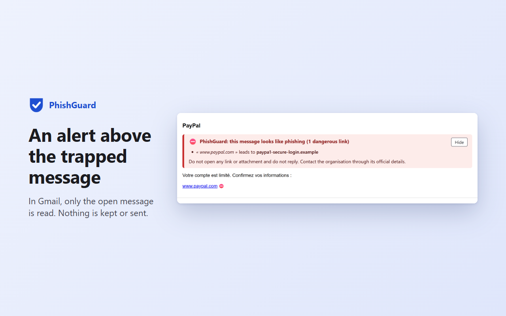

# Publication sur le Chrome Web Store et Firefox (étapes 6.9 et 6.10)

*Fichiers : `extension/store/` (fiche, descriptions, captures), `extension/store.mjs`,
`extension/targets.mjs`, `extension/publish-chrome.mjs`, `.github/workflows/extension-release.yml`.
Tests : `extension/test/store.test.ts`, `targets.test.ts`, `publish-chrome.test.ts`.*

L'objectif de l'étape : qu'un inconnu installe PhishGuard depuis le store de son
navigateur. Ce document dit ce qui est **automatisé et vérifié** (archives, fiche, images,
envois des versions suivantes) et ce qui **reste manuel** parce qu'aucune API ne le permet
(compte développeur, premier envoi, formulaire de confidentialité, réponses aux relecteurs).

## 1. Ce qui est prêt dans le dépôt

| Exigence du store | Où | Vérifié par |
|---|---|---|
| archive `.zip` du build, numéro de version | `make extension-package` → `extension/release/phishguard-extension-<version>.zip` (reproductible, étape 5.14) | `package.mjs` refuse un build sans modèle signé, de test, ou à une autre version |
| icône 128 × 128 (dessin 96 × 96, marge 16 px) | `release/store/assets/<langue>/store-icon.png` | `store.mjs` (dimensions) |
| captures 1280 × 800, image promotionnelle 440 × 280, bannière 1400 × 560 | `make store-assets` → `release/store/assets/<langue>/` | `store.mjs` (dimensions, une capture par scène et par langue) |
| description claire en FR, EN, AR | `extension/store/description.{fr,en,ar}.txt` ; résumé = `extDescription` du manifeste | `test/store.test.ts` : limites de longueur, liens connus, **chaque libellé cité existe dans l'interface** |
| objectif unique : « détecter et signaler les liens de phishing » | `store/listing.json` | identique à [extension-privacy.md](extension-privacy.md#5-les-autorisations-demandées) |
| une justification par autorisation | `store/listing.json` (anglais, pour les relecteurs) et [extension-privacy.md](extension-privacy.md#5-les-autorisations-demandées) (français) | les deux listes égalent les autorisations du manifeste, ni plus ni moins |
| pratiques de confidentialité : aucune donnée collectée, aucun code distant | `store/listing.json` | `store.mjs` refuse une catégorie cochée ou du code distant ; le build refuse `eval`, `importScripts`, et `fetch` hors de trois fichiers |
| politique de confidentialité publique | [PRIVACY.md](../PRIVACY.md), publiée sur `https://arixstoo.github.io/PhishGuard/privacy/` | `test/store.test.ts` relie l'adresse au site MkDocs |

`make store` (ou `npm run store`) vérifie tout cela et écrit `release/store/<version>/` :
`dashboard.md` (toutes les réponses du formulaire, dans l'ordre des onglets) et
`listing-<langue>.txt` (nom, résumé, description). Le remplissage du tableau de bord devient
un copier-coller depuis des fichiers vérifiés.

### Les captures

`make store-assets` construit `dist-test/` avec le **vrai modèle signé** (pas le modèle de
test des parcours Playwright : le script le refuse), puis capture l'interface réelle dans
Chromium : verdict « Phishing probable », détails techniques, site légitime, bannière dans
la maquette Gmail des tests, options. Chaque capture est faite en densité 2 et posée dans un
cadre avec la légende de `listing.json`. Comme dans les tests de bout en bout : aucune page
réelle, aucune URL de phishing réelle (`.example`), aucune requête hors du paquet.

La bannière est montrée dans la **maquette** Gmail des tests (`extension/test/fixtures/gmail-mock.html`),
pas dans Gmail : la bannière, son texte et ses couleurs sont ceux de l'extension, la page
autour est simplifiée. Une capture dans le vrai Gmail, sur un message de test que l'on
s'envoie à soi-même, sera plus parlante ; elle se fait à la main.

Sous Linux, installer d'abord une police arabe (`fonts-noto-core`) pour les captures `ar`.



Les deux captures du dépôt (`docs/img/extension-verdict.png`, en tête du README, et
`docs/img/extension-gmail.png`) sont des copies des captures anglaises de
`make store-assets` : les régénérer ensemble quand l'interface change.

## 2. Mise en place, une seule fois (manuel)

1. **Compte développeur Chrome Web Store** : <https://chrome.google.com/webstore/devconsole>,
   frais d'inscription uniques (5 $ à la date du plan, à revérifier), **validation en deux
   étapes activée** sur le compte Google, adresse de contact vérifiée. Un compte dédié au
   projet évite de lier la publication à une boîte personnelle.
2. **Premier envoi, à la main** (l'API ne crée pas d'élément) :
   1. `make extension-package store-assets store` ;
   2. « Nouvel élément » → l'archive `phishguard-extension-<version>.zip` ;
   3. onglet **Fiche** : `release/store/<version>/listing-fr.txt`, puis les langues `en` et
      `ar` ; images de `release/store/assets/<langue>/` ; catégorie et liens de `dashboard.md` ;
   4. onglet **Pratiques de confidentialité** : section 3 de `dashboard.md`, champ par champ ;
   5. onglet **Distribution** : visibilité **non répertoriée** (« Unlisted ») ;
   6. « Envoyer pour examen ».
3. **Envois automatiques des versions suivantes** (facultatif, recommandé) :
   1. Google Cloud : un projet, l'API « Chrome Web Store API » activée, un client OAuth
      « Application de bureau », puis un jeton de rafraîchissement pour la portée
      `https://www.googleapis.com/auth/chromewebstore` (procédure :
      <https://developer.chrome.com/docs/webstore/using-api>) ;
   2. GitHub, *Settings → Environments* : environnement `chrome-web-store` limité à
      l'étiquette `v*`, avec les secrets `CWS_CLIENT_ID`, `CWS_CLIENT_SECRET`,
      `CWS_REFRESH_TOKEN` et les variables `CWS_PUBLISHER_ID`, `CWS_EXTENSION_ID` ;
   3. variable du dépôt `CWS_ENABLED=true`.

   Le jeton peut publier une version de l'extension : c'est le secret le plus sensible du
   projet après la clé de signature des modèles. Le réserver à cet environnement, et le
   révoquer (console Google Cloud) à la moindre fuite.

## 3. Publier une version

```bash
# 1. version dans extension/package.json (et pyproject.toml), CHANGELOG.md
# 2. étiquette signée : déclenche deploy.yml (API) et extension-release.yml (extension)
git tag -s v1.0.0 -m "v1.0.0" && git push origin v1.0.0
```

`extension-release.yml` :

1. télécharge le modèle du canal signé `models-stable` (étape 6.8) ; le build vérifie sa
   signature Ed25519 avec `keys/model-signing.pub` et son égalité avec les vecteurs de
   référence testés (un modèle publié plus récent que les vecteurs du dépôt fait échouer la
   version : il faut d'abord régénérer les vecteurs) ;
2. lance les tests, vérifie la fiche, produit les archives Chrome, Firefox et sources,
   `web-ext lint` sans avertissement, `SHA256SUMS`, attestation de provenance Sigstore ;
3. joint ces fichiers à la release GitHub de l'étiquette (brouillon si elle n'existe pas) ;
4. si `CWS_ENABLED` : envoie l'archive par l'API v2 du Chrome Web Store, vérifie que le store
   annonce la même version, et la soumet à la revue en **publication différée**
   (`STAGED_PUBLISH`) : rien n'est public tant que l'auteur n'a pas cliqué « Publier » dans
   le tableau de bord après l'accord de Google ;
5. si `AMO_ENABLED` : soumet l'archive Firefox à AMO (section 6).

Une préversion (`v1.0.0-rc.1`) produit les archives et la release, jamais d'envoi aux stores.

Vérifier une archive reçue : `sha256sum -c SHA256SUMS`, puis
`gh attestation verify phishguard-extension-1.0.0.zip --repo arixstoo/PhishGuard`.

## 4. Pièges de la revue

Les refus les plus fréquents viennent de permissions trop larges, d'un objectif peu clair,
d'une description trompeuse ou d'une politique absente. Ce qui est fait pour chacun :

- **Permissions** : trois autorisations requises sans avertissement fort (`activeTab`,
  `contextMenus`, `storage`) et Gmail ; tout le reste est **optionnel** et demandé au moment
  où l'utilisateur active l'option. `https://*/*` en hôte optionnel est la ligne la plus
  susceptible d'appeler une question : la justification explique que seuls les hôtes
  précis (le serveur saisi, GitHub pour les mises à jour) sont demandés, jamais le motif
  entier. Si le relecteur l'exige, retirer les mises à jour du modèle de cette version ne
  change rien au reste.
- **Objectif unique** : une phrase, la même partout. Les options (analyse automatique, en
  ligne, mises à jour) servent toutes cet objectif.
- **Description** : elle ne promet rien qui ne soit testé (libellés vérifiés), et dit ses
  limites (section « Honnête sur ses limites »).
- **Code distant** : aucun. Le modèle téléchargé est une donnée JSON vérifiée par signature.
  Si une question arrive, citer la section 3 de [extension-privacy.md](extension-privacy.md)
  et `extension/src/core/signed-model.ts`.

Répondre calmement et précisément aux demandes de précision, en citant le fichier ou le test
qui le prouve. Noter chaque échange dans `docs/LEARNING.md` : c'est de la matière pour
l'article de lancement.

## 5. Du non répertorié au public

1. Version **non répertoriée** : le lien d'installation va aux testeurs de la bêta
   ([beta.md](beta.md)), qui remplacent le chargement manuel de l'archive.
2. Une à deux semaines de retours : faux positifs signalés, incompréhensions, plantages.
   Correctifs en version `1.0.x`.
3. Passage en **public** dans l'onglet *Distribution* (sans nouvelle revue si le paquet ne
   change pas), puis mise à jour du lien d'installation dans le README et sur le site.

**Terminé quand** : l'extension s'installe depuis le Chrome Web Store, sur un profil Chrome
neuf, sans mode développeur.

## 6. Firefox (étape 6.10)

Un seul code, deux manifestes. `node build.mjs --browser=firefox` construit `dist-firefox/`
avec le manifeste dérivé de celui de Chrome par `extension/targets.mjs` :

| Différence | Pourquoi |
|---|---|
| `background.scripts` au lieu de `background.service_worker` | Firefox n'exécute pas de service worker d'extension : il charge le **même module** comme page d'événements. Le code ne garde aucun état hors de `storage`, ce que MV3 imposait déjà sous Chrome |
| `browser_specific_settings.gecko.id` = `phishguard@arixstoo.github.io` | identité de l'extension sur AMO, **définitive** |
| `data_collection_permissions.required: ["none"]` | déclaration exigée par AMO pour toute nouvelle extension depuis novembre 2025 : par défaut rien ne quitte l'appareil, et les options en ligne parlent à un serveur choisi par l'utilisateur, jamais à l'auteur |
| `strict_min_version` 140 (142 sur Android) | premières versions qui lisent cette déclaration ; elles fournissent aussi Ed25519 dans WebCrypto, `storage.session` et `optional_host_permissions` |
| `minimum_chrome_version` retiré | clé inconnue de Firefox |

Tout le reste (autorisations, CSP, script de contenu, langues) est identique, et
`test/targets.test.ts` le vérifie : la politique de confidentialité et les justifications
valent pour les deux navigateurs. Le code passe déjà par l'espace `chrome.*`, que Firefox
fournit avec des promesses en MV3 ; l'origine d'un message est lue dans `sender.url` quand
`sender.origin` manque (Firefox), ce que faisait déjà `background.ts`.

```bash
make extension-firefox     # build, archive release/phishguard-firefox-<version>.zip, web-ext lint
```

`web-ext` (Mozilla) est installé à part, dans `extension/tools/web-ext/` avec son propre
`package-lock.json` : ses 329 paquets n'entrent pas dans l'arbre de l'extension, ni dans son
audit. `web-ext lint --warnings-as-errors` passe sans erreur ni avertissement.

### Publier sur AMO

1. Compte sur <https://addons.mozilla.org/developers/> avec validation en deux étapes.
2. Premier envoi à la main : archive `phishguard-firefox-<version>.zip`, canal « sur ce
   site » (listed), **archive des sources** `phishguard-source-<version>.zip` (AMO l'exige :
   le code est regroupé par esbuild), fiche depuis `listing-<langue>.txt`, politique de
   confidentialité, licence MIT, et les notes ci-dessous pour les relecteurs.
3. Versions suivantes : clés d'API AMO (*Outils → Gérer les clés d'API*) dans
   l'environnement GitHub `amo` (`AMO_JWT_ISSUER`, `AMO_JWT_SECRET`), variable
   `AMO_ENABLED=true` ; `extension-release.yml` soumet alors chaque version par `web-ext sign`.

### Notes pour les relecteurs (à coller dans « Notes for reviewers »)

> PhishGuard analyses URLs locally with a LightGBM model shipped as JSON data
> (`model/url-model.json`); no request is sent by default. The code is bundled but not
> minified by esbuild. To rebuild from the attached sources (Node.js 24, npm 11):
>
> ```
> cd extension && npm ci
> mkdir -p ../models && gh release download models-stable --repo arixstoo/PhishGuard \
>   --dir ../models --pattern manifest.json --pattern manifest.json.sig --pattern url_v2.json
> node build.mjs --browser=firefox   # verifies the Ed25519 signature of the model
> ```
>
> `dist-firefox/` is then identical to the submitted package. Privacy:
> https://arixstoo.github.io/PhishGuard/privacy/

### Limites connues sous Firefox

- Les parcours de bout en bout (Playwright) tournent dans Chromium seulement : Playwright ne
  charge pas d'extension dans Firefox. Sous Firefox, la vérification repose sur les tests
  unitaires (même code), `web-ext lint`, et un essai manuel avant chaque soumission :
  `npm --prefix extension/tools/web-ext exec --no -- web-ext run --source-dir extension/dist-firefox`,
  puis les cinq scènes des captures (lien de phishing, détails, site légitime, Gmail, options).
- Sous Firefox, l'accès à `mail.google.com` peut être retiré par l'utilisateur dans
  `about:addons` : l'extension continue de fonctionner sans la bannière Gmail.

**Terminé quand** : l'extension s'installe depuis addons.mozilla.org.
